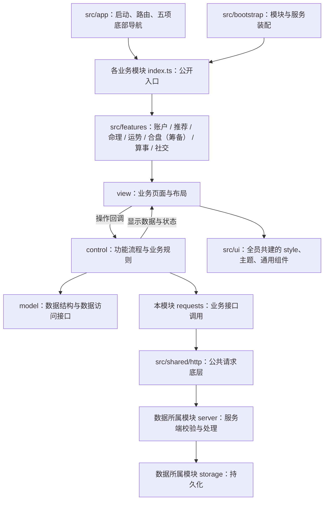
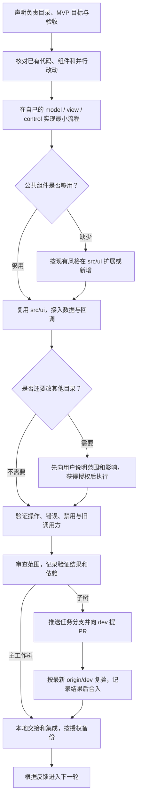

# app 框架图与协作说明

对应协作协议 **v1.2**：先做 MVP，再根据反馈迭代。本文描述目标组织方式；本轮仅更新 Markdown，现有代码路径、页面行为和运行方式保持原状。完整开工规则见 [COLLABORATION.md](COLLABORATION.md)。

## 整体框架



箭头表示调用或提供数据关系，不表示有权修改目标目录。跨业务模块只使用明确开放的入口；公共 UI 不反向导入业务实现。服务端业务流程逐步采用所属模块 control 的组织方式，服务端权限校验独立于客户端执行。

导航目标为「命理、合盘、算事、消息、个人中心」。运势保留独立业务模块，计划从命理首页进入，并保留 `/fortune` 旧路径。第二个底栏位置计划接入[合盘](src/features/synastry/README.md)。当前接线状态见[应用入口与导航](src/app/README.md)。

## 目标目录

以下是后续新建与渐进整理时使用的模板，**不是声称这些目录已全部落地**。现有文件不因规范发布立即移动。

```text
app/
├── AGENTS.md                     开工规则
├── COLLABORATION.md              可分发给每位负责人的协议
├── FRAMEWORK.md                  本框架说明
└── src/
    ├── app/                     应用启动和路由；改动需本轮授权
    ├── bootstrap/               模块与服务装配；改动需本轮授权
    ├── shared/                  公共 HTTP 与共享契约；改动需本轮授权
    ├── ui/                      全员共同维护
    │   ├── theme.ts             现有统一 style 来源之一
    │   ├── Button.tsx           现有公共组件示例
    │   └── ...                  兼容扩展或新增可复用组件
    └── features/
        ├── account/             账户、资料、隐私及用户归档
        ├── recommendation/      推荐、兴趣、用途授权与反馈
        ├── destiny/             命理
        ├── fortune/             运势
        ├── synastry/            合盘，当前为筹备文档
        ├── divination/          算事
        └── social/              社交；底栏消息入口

每个业务模块的目标模板：
<模块>/
├── AGENTS.md / README.md         职责与写入边界
├── index.ts                     明确的公开入口
├── model/                       数据结构、数据状态及访问接口
├── view/                        具体页面、布局、业务专用组件
├── control/                     功能流程、校验、计算和状态协调
├── requests/                    本模块业务请求，继续保留
├── server/                      有服务端需求时才添加
└── storage/                     有持久化需求时才添加
```

账户保留 auth、profile、reading-profile、settings、wallet、history 等分工；各子功能按需采用 model/view/control。账户模块级三层只容纳跨子功能代码，不另复制子功能实现。server/storage 属于适配层，不需要为了凑齐目录创建空 view。各层使用简单函数、hooks 和类型即可，不引入额外 MVC 框架依赖。

现有 screen.tsx、model.ts 等可在后续对应功能任务中迁入目标层，并保留 index.ts 的外部兼容。本轮不创建空三层目录、不改引用，也不把占位页面当作已实现的业务。

## 谁可以改哪里

| 位置 | 默认修改与提交规则 |
| --- | --- |
| 自己认领的 features 模块 | 可以；限本轮目标，独立子目录任务按更窄范围 |
| 其他人的 features 模块 | 不可以自行改；先向用户询问具体范围并获得明确授权 |
| src/ui | 大家共同维护；限本轮相关的样式、兼容组件扩展或新增 |
| 路由、bootstrap、shared、根文件、依赖和 CI | 非认领范围时，先向用户询问并获得明确授权 |
| 其他人的未提交改动 | 保留，不恢复、不顺手提交；交叠内容无法判断时向用户确认 |

共享 UI 仍需检查已有调用方。破坏性参数或事件变更、全局风格调整先向用户确认。普通模块可以提交自己的业务文件和相关 UI 文件，不能借此改其他业务目录。现有 check:scope 只支持单目录，混合提交按协作协议人工审查暂存区和逐提交路径；脚本升级未在本轮实施。

> **跨板块协作**　其他板块的代码可以阅读和参考，可通过对方明确开放的入口或公共 UI 复用能力。需要修改认领范围外的文件时，包括其他板块的代码、业务页面和说明文档，须先向用户说明具体文件、原因和影响，取得明确授权后再修改。

## 一轮迭代如何协作

集成负责人指定持久主工作树，用于本地开发和集成。账户直接在主工作树开发。子树经 GitHub PR 向 `dev` 交付，集成负责人接收后在主工作树复验。



例如命理要增加“出生资料输入并提交”：命理 view 组织字段，control 处理校验与提交，model 定义数据结构，requests 调用已约定接口。缺少通用选择器时可在 src/ui 新增并复用现有主题。若账户尚未开放出生资料接口，命理记录所需字段与用途，交由用户协调账户提供方，不能自行改 account 或读取其数据库。需要保存结果时，通过账户公开接口归档。

每轮只完成约定的 MVP。接口缺失时可以交付明确标注的本地替代，后续接真实接口；不能把占位数据或静态页面描述为真实功能已验收。

## 每轮交付说明

```text
本轮完成的 MVP / 仍待迭代：
实际改动的业务模块与目录：
公共 UI 组件、导入路径、示例与支持状态：
其他目录改动及用户授权：
对旧页面的影响、并行工作可能冲突处：
临时实现、已替换位置与剩余依赖：
验证方式与结果、未验证内容：
暂存及逐提交范围检查结果、提交与合入状态：
```

没有代码或公共组件变更时明确写无。所有负责人遵守相同边界；只持有模块副本时说明验证限制，并交付自己的目录及必要的公共 UI 文件清单。
