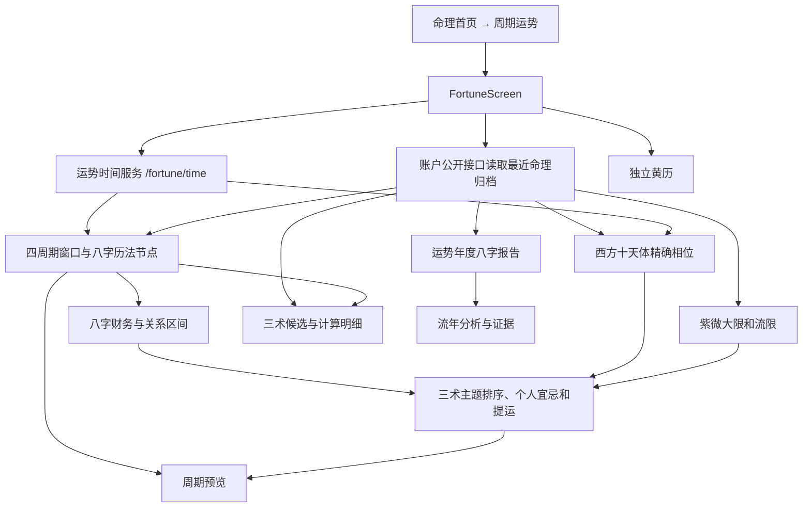

# 四周期运势现状审查

本次核对基线为 `eff1751`。待合入的运势提交 `8d2206b` 提供年度八字分析、证据引用和离线预览，页面依赖该基线缺少的命理离线公开入口。本轮复用可独立运行的年度报告、页面和测试，使用现有账户公开归档。授权写入范围为运势目录。

## 现有数据流

## 锁定工具与许可证

| 锁定工具 | 版本 | 许可证及核验 | 用途与限制 |
| --- | --- | --- | --- |
| [lunar-javascript](https://github.com/6tail/lunar-javascript) | 1.7.8 | 安装包 `LICENSE` 为 MIT | 运势现有节气、干支和十神，本轮用于传统黄历。包内宜忌为通用资料。 |
| [iztro](https://github.com/SylarLong/iztro) | 2.6.5 | 安装包 `LICENSE` 为 MIT | 由单一序列化本命盘恢复流限计算，局部套用归档对应配置。内部入口随锁定版本联动验证。 |
| [Astronomy Engine](https://github.com/cosinekitty/astronomy) | 2.1.19 | 安装包 `astronomy.js` 文件头为 MIT | 沿用命理的 `SunPosition` 和地心黄经算法，为十个天体扫描精确同体相位和逆行。 |
| 运行时 `Intl.DateTimeFormat` | 随运行时 | 复用现有运行时，无新增包 | 解析 IANA 展示时区。部署时区数据库版本由运行环境提供。 |
| Swiss Ephemeris / Temporal polyfill | 无锁定项 | 本轮无集成 | 现有依赖可满足本轮交付。 |

核验针对锁文件与本机安装产物。打包分发时按项目发布流程核对第三方许可证声明。

## 字段映射

| 运势输入 | 当前来源 | 范围 |
| --- | --- | --- |
| 当前 UTC | `GET /fortune/time → asOfUtc` | 已实现。未配置或失败时标记设备时间预览。 |
| 展示时区 | 设备提供的 IANA 候选值 | 经运行时校验，作为周期窗口和显示的显式输入。 |
| 当前档案与权限 | `useAccountSession` 与 `requestLatestDestinyArchive` | 识别会话归属，账户侧校验权限。 |
| 本命八字 | `report.chartSnapshot.bazi.rawResult`、`rulesetVersion`、`timeKnown` | 多候选只取一致事实。缺原始候选时回退到旧摘要的明确日柱。 |
| 紫微、西方本命盘 | `report.chartSnapshot.ziwei`、`report.chartSnapshot.western` | 核对引擎和规则版本。紫微需要已确认时刻和单一候选，西方按天体读取候选一致的黄经。 |
| 出生档案 ID、时区偏好、关系状态、运势归档 | 暂无可直接使用的运势契约 | 见 [跨模块交接](FORTUNE_HANDOFF.md)。 |

## 接入边界

四周期、黄历、三术排序和建议接入现有页面。运势报告持久化、外部启动配置、命理离线入口及紫微对外适配列入交接。

账户接口按 `dev@603bec2` 核对。公开的 `requestLatestDestinyArchive` 与 `requestDestinyHistoryRecord` 按会话归属返回命理归档，`report.chartSnapshot` 提供八字、紫微、西方星盘的原始候选、引擎及规则版本、出生时刻完整度和采样版本。旧工作树 `454eb17` 的账户实现及早期归档可能只提供摘要，运势可继续用明确的摘要日柱计算十神。

| 能力 | 归档已提供 | 后续接入所需 |
| --- | --- | --- |
| 八字 | 四柱、十神、神煞、候选 UTC。当前预览核对各候选日柱。 | 计算明细已输出四层流柱与关系，以及北京时间分钟折算的两种顺逆起运结果。选定正式起运口径需要明确的出生地时区、出生性别来源和采用的流派。 |
| 紫微 | `iztro` 原始盘含公历出生日期、时辰、性别、宫位、星曜、各宫大限 `decadal` 及小限年龄 `ages`。 | 计算明细逐候选展开六层流限、十二宫及四化。按候选加权、化曜吉凶解读和流派对照需要另行定义。 |
| 西方星盘 | 星体黄经、宫位、上升、天顶、相位、儒略日及候选 UTC。 | 计算明细已输出跨天体与轴线相位、6° 容许度、整宫入宫及天象相位。容许度可以随后续规则按相位和天体细化。 |
| 出生档案关联 | 归档记录 ID、出生时刻是否已知及候选数据。 | 按同一个出生档案跨报告归档时，需要稳定的出生档案 ID。重新按出生地规则排盘时，需要原始出生日期、时刻及 IANA 时区的公开读取契约。坐标按具体算法需要读取。 |
| 参考时刻 | 运势独立服务返回当前 UTC。 | 用户偏好时区目前没有公开读取入口，预览按设备时区展示。 |

部分盘可能因输入不完整而没有原始候选，运势按可用候选和记录提示决定能展示的内容。三术排序与行为建议按试用规则展示，通用黄历单独查询。历史归档仍需公开契约。

## 验证结果

`typecheck`、`check:boundaries`、运势 36 项测试及整仓 141 项测试通过。新增用例覆盖四周期分层时间线、深夜时柱、顺逆起运和小运、紫微六层运限及闰月分段、西方跨天体相位与轴线、多候选隔离、整宫入宫和主月相对照。Expo Web 使用同盘临时副本导出，确认包含 `/fortune` 和三术明细。当前工作树的跨盘依赖链接会导致 Expo 导出资源路径失败。真机及实际账号验证待执行。
