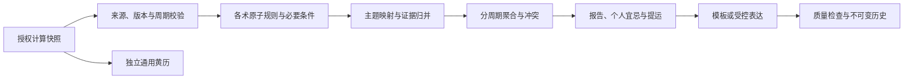

# 运势解读层 V1 接入记录

以下为首版接入时的记录。当前四周期使用内置规则筛选资料库要点，并由 DeepSeek 撰写用户正文。运行方式见[周期解读](README.md#周期解读)。

四周期事实来自 `calculateFortuneFacts`。运行号、快照号、原始依据、方法状态、引擎版本与有效区间均已可用。现有服务可保存和回放计算快照，账户公开归档负责授权身份。当前仍由归档记录标识本命盘，出生档案 ID 和资料版本按上游实际提供情况保留。

旧预览直接把十神、合冲、单宫和相位接入主题、排序与建议。它缺少规则审核、反向证据、条件、跨周期去重和独立解释运行号。旧入口将接到已标准化的周期事实。流年明细、历法、通用黄历继续提供原有独立查询。

本轮查阅了命理模块的心理共鸣材料登记、审核状态及数据结构。该库适用于本命报告，未发现可直接发布到四周期运势的审核规则。首批运势草案来自用户提供的 V1 实施规范与项目原创行为说明。没有引入现代书籍和网站原文，术数语义与授权待真实审核人确认。

| 项目 | 状态 | 位置与边界 |
| --- | --- | --- |
| 事实适配、规则 DSL、来源登记 | `implemented_and_tested` | `control/fortune-interpretation.ts`、`control/interpretation-registry.ts`、`model/interpretation.ts`。只读取快照，验证归档、周期、原始依据链和方法版本。 |
| 三术原子规则、主题映射 | `blocked_by_source_review` | `control/interpretation-rules.ts` 内置原创草案，覆盖八字十神、藏干与柱关系，紫微十二宫与分层四化，西方十天体、五大相位和整宫。日主强弱、正式起运、专业四化流派及完整星曜规则需要经审核的资料与上游字段。 |
| 聚合、边界、冲突和重复经过 | `implemented_and_tested` | 按年度结构、月内阶段、整周持续性和当日有效窗口取证。弱映射保留作线索。相反方向和不同时间按证据区分。对候选专属事实采用保守排除。 |
| 综合、财运、桃花、个人宜忌与提运 | `partially_supported` | 仅在必要条件齐备时形成报告标题和行动。内置环境、行为与习惯需要审核。饰品、颜色、方位有目录契约，真实来源、体系、场景与审查仍待补。 |
| 表达与质量门 | `implemented_and_tested` | 运势服务通过 DeepSeek 撰写用户正文，校验栏目和事实引用，见[当前运行方式](README.md#解读规则与历史报告)。 |
| 快照保存与新版规则重读 | `implemented_and_tested` | `server/interpretation-service.mjs`、`server/fact-service.mjs`。授权后保存，规则内容或偏好改变会生成新 ID，可继续查询旧报告。 |
| App 接入 | `partially_supported` | `screen.tsx`、`control/useFortuneInterpretation.ts`、`view/FortuneInterpretationView.tsx`。草案可本地预览。正式请求目前通过 Web 的账户 Cookie，原生端等待账户公开认证接线。 |

审核时逐条确认流派、事实版本、必要条件、排除项、反例与周期。正式规则、主题映射、建议规则和目录均需独立核对来源许可与实际审核记录。内置草案没有填写审核人。规则包升级应提升版本，同一个计算 ID 可以重新解释。旧版流年专题在入口标注为预览，便于区分。

本轮运势 54 项、整仓 159 项回归测试通过。TypeScript、模块边界及改动范围检查通过。同盘临时副本的 Expo Web 导出包含解读路由和规则。正式服务使用测试审核记录和授权替身验收，真实审核、实际账号及原生端正式认证待联调。
