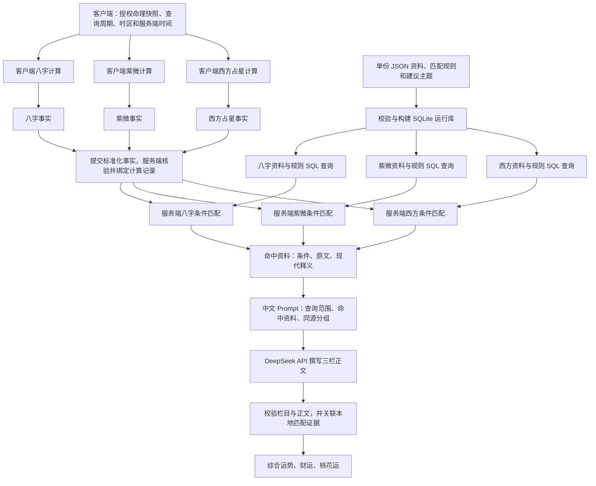

# 运势输入、事实、匹配与资料库

本轮基于 codex/fortune/four-periods 的 ec26a00 及此前未提交的 API 正文接线继续开发。修改范围为运势模块。

## 数据流程

排除条件随证据的实际时段生效。SQLite 分别记录成立、已判定不成立及待核的排除证据。某条排除条件部分待核时，只有同段有已判定不成立的证据且无重叠待核证据的区间才能进入确认；全段缺证据仍待核。以第 337 条的前后回归段验证互不重叠、部分重叠及明确排除。匹配器版本 v12。

## 文件与职责

六条《全书》资料新增第67种中文投影：[身命与同段岁限](ZIWEI_BODY_LIMITS.md)。身宫按生月生时独立重算，身、命及太岁二限不混拼；源生年四化与未核年度延用分列，六条仍部分，不发送成完整命中原文。

三条太岁干合资料使用[本命同柱与制合见证](BAZI_ANNUAL_RELATIONS.md)，新增第66种中文投影。日时干与岁干、同一柱干支俱合分别核，庚申整柱与透藏、大运见证不混拼；未知不当作没有，三条仍为部分映射。

36条Leo上升规则改用[本命与十分度上下文](LEO_ASCENDANT.md)，新增第65种显式中文投影。主星本命位置与实际推运片段相连，同期方向按全部边界分段；第一段原文仍适用于整座。原JSON不改，辅助版本和各条未核分支仍保留，完整条数不增加。

| 层 | 文件 |
| --- | --- |
| 输入与时间 | model/fortune-facts.ts、control/fact-time-context.ts |
| 客户端事实提交与服务端校验 | control/fortune-fact-submission.ts、requests/fortune-interpretation.ts、server/client-facts.mjs |
| 八字算法与事实 | control/bazi-calculation.ts、control/facts/bazi.ts |
| 紫微算法与事实 | control/ziwei-flows.ts、control/facts/ziwei.ts |
| 西方算法与事实 | control/solar-transits.ts、control/facts/western.ts |
| 西方次限计算 | control/western-progressions.ts（区别于实际天空行运） |
| 统一事实信封与兼容入口 | control/facts/context.ts、control/fortune-facts.ts |
| 资料、匹配规则和建议主题 | [model/knowledge/fortune_knowledge.json](model/knowledge/fortune_knowledge.json) |
| SQLite 构建与只读查询 | storage/knowledge/database.mjs |
| 手动构建与条数检查 | storage/knowledge/manage.mjs |
| 服务端读取器装配 | server/knowledge/runtime.mjs |
| 加载与匹配 | control/knowledge/catalog.ts、control/knowledge/match.ts |
| Prompt 与 API | control/fortune-model-context.ts、server/deepseek-expression.mjs |
| 自然语言转换 | control/fortune-prompt.mjs |

事实由对应方法单独生成，facts 和 rawFacts 保留原公开格式，factGroups 按方法登记事实编号。方法失败时保留其余方法结果。匹配只读取已校验、版本相符、时间有效的事实，候选不确定时不能拼成一份确定结论。

原文、原始条件和现代释义集中保存，和相应的机器规则放在同一条目。启动时读取 JSON 字节校验版本和构建，运行时解读和建议只查询 SQLite。匹配层读取 `matchConditions.formatted` 中的必需条件、排除条件和未映射项。原文条件保留供核对。

## 单文件资料结构

`fortune_knowledge.json` 使用两空格缩进。当前 `schemaVersion` 为 2。解读按 `year`、`month`、`week`、`day`、`hour` 分组，建议保存在 `advice`，建议主题保存在 `adviceGroups`。编辑时保留已有条目的整数 `id`，新条目使用全库未占用的正整数。`source` 保存书名、具体位置和可空的网址，`originalText` 和 `modernInterpretation` 可以为 `null`。迁移条目的 `legacyId` 用于历史报告和接口引用，`legacy` 保留旧标题、出处、条件和局限。

`category.method` 可选 `bazi`、`ziwei` 或 `western`。`category.topic` 的 `overall`、`wealth` 和 `romance` 对应综合运势、财运和桃花运。解读的 `category.period` 必须与所属周期分组一致。小时条目按该条出处填写 `hourBasis`，`shichen` 表示时辰，`clockHour` 表示一个小时。时区、起算边界等特定条件写进对应规则。页面提供今日、本周、本月和本年四个入口。周运使用整周计算结果查询 `week` 条目，日运使用当日计算结果查询 `day` 条目。`hour` 分组目前为空。周运无命中时服务直接返回提示。

`category.contentType` 为「解读」或「建议」。建议条目可将周期设为 `null`，并填写 `advice.kind`、`advice.options` 和 `advice.basis`。在 `adviceGroups[].themes[].entryIds` 填入同术数的建议条目 ID，以建立主题索引。「今日」按命盘匹配的主题另填分组 `natalField` 和主题 `natalValue`。新增待核的解读可先保存原文和缺项，已核的机器条件填入 `queries` 和 `unless`。

`matchConditions.status` 标记解读规则的接入状态。`mapped` 表示规则已启用，须有至少一条 `formatted.queries`。`unmapped` 表示规则未启用，正文、审阅和草稿条件可继续保存。规则完整度由 `formatted.unresolved` 记录。建议条目在此处填 `unmapped`，由 `adviceGroups` 管理实际匹配。

完整映射可用 `formatted.sourceConditions` 保存审核后的静态条件说明。规则实际命中时，模型读取这份说明。历史条目的原条件继续保留供审计。

部分映射中已有独立、充分的原文路径时，可以用 `formatted.confirmedWhen` 核验第一项必需查询命中的同一条事实。单条用查询对象，多条用查询对象数组。SQLite 分别核各条确认条件、其余必需条件和排除条件。每条路径在 `sourceConditions` 写固定的原文条件说明。只有实际命中的路径进入解读，各路径的证据和有效时段在本地分列，未确认的其余时段留在 `candidateWindows`。模型输入只包括实际命中路径的静态说明、原文和现代释义。全库审计仍按原有剩余条件计数，`--groups` 对这种部分映射标记 `hasConfirmedRoute`。

原文同时述及已确认和待核情形时，可以在每个确认对象设置 `sourceExcerpt`。SQLite 导入时逐条检查短引是原条目 `originalText` 的连续文字，或与审阅中 `additionalSourceExcerpts` 的一条同出处短引完全一致。审阅新增短引时，必须能在该条 `source.url` 核到，并保留原有资料正文。同一条目采用此字段时，每个确认对象都应提供短引。解读只使用已命中路径的短引。

### 复用已有盘面事实

`matchConditions.original` 保留原文条件。`matchConditions.formatted` 可用已提交的盘面字段表达等价条件。例如，某条规则要求同一盘层出现指定干支与对应柱位时，可以在已有的柱位事实中一起核对。新增规则先查已有事实字段和来源口径，只有无法确认等价时才需要补算或记录缺项。

`where` 的字段在同一条事实中同时成立。`anyOf` 的每个分支也在同一条事实中判断，可表示同一来源允许的几种情况。涉及盘层、出生候选、有效时间、边界或强弱口径时，把这些限制一并写入机器规则或保留待核项。改写后在 `review.mappedConditions` 记录依据，至少用一个命中样本及容易混淆的反例核对。已有事实缺字段时按未知处理。

第 99、100 条甲日酉月规则在同一条八字事实的 `youOfficerRoutes` 中查找各自允许的路线。用 `includesAny` 表达备选路线，同时核对命盘时刻和大运确认状态，保留原有官星强弱缺项。第 39 条日运匹配使用的流日冲合也从同一候选、同一时间段已算好的干支关系中取用，仍按来源对应的柱位和节气边界核对。[统一资料源](model/knowledge/fortune_knowledge.json)

### 待核验的西方行运资料

原有 1,362 条以西方星体、相位和宫位象意编写的现代释读，现统一标为 `unmapped`。条目和草稿查询供复核。过宫草稿采用整宫和停留时数，原书使用具体宫头度数并结合本命星相。一般相位章节也不足以验证每个草稿指定的星体组合、适用周期及成相条件。

新增条目的现代释读由项目编写，`originalText` 留空。星体、相位和宫位的传统象意参照 Sepharial 第一部第一、三、四章与第四部第二、七章，以及托勒密《四书》第一卷第十三章。阈值是项目的筛选口径。 [Sepharial 原书](https://ia802804.us.archive.org/23/items/astrologyhowtoma46963gut/46963-h/46963-h.htm) [托勒密《四书》](https://penelope.uchicago.edu/thayer/e/roman/texts/ptolemy/tetrabiblos/1b%2A.html)

## SQLite 构建与资料更新

SQLite 对待核验条目保留原 ID 和资料，规则查询保持空。报告默认读取使用当前规则的结果，历史报告仍可通过报告编号访问。

新增的八字与紫微年运首批各一条，分别核验《三命通会》论太岁的庚岁克甲日，以及《紫微斗数全书》论流年太岁吉凶星杀的癸生人命在子、流年太岁到子。两条各自只确认原著例型与当前时段，不替代其他吉凶条件。新增规则的 `review.ruleHash` 绑定分类、周期和完整机器条件，条件变动后须重新核对再更新哈希。旧资料仍按条目记录核查进度。[《三命通会》论太岁](https://zh.wikisource.org/zh-hant/三命通會/卷二#論太歲) [《紫微斗数全书》论流年太岁吉凶星杀](https://zh.wikisource.org/wiki/紫微斗數全書/卷三#论流年太岁吉凶星杀)

八字流日第 2231 条按拨云首例核癸水身强、庚申运的实际丙申日。丙火为用，申中金在该例喜忌表中未列。第 2232 条按同文核流日天干确属原局已明列的忌神。第 37 条改为核第二例庚辰日的「庚金为用、辰土为忌」这一方向。第 34、35 条只按所冲柱位解释变化范畴，喜忌待另核。日干与支本气各用对应盘面的证据，程序扶抑候选不可替代作者明列的喜忌。[拨云流日原文与两个实例](https://fateclear.com/zh-hant/learn/bazi/dayun/liu-ri)

紫微流日第 2233 条合录令东来例 11、12 的同一盘面条件，先按斗君顺数定位当日迁移宫，再核天相的实坐宫。第 2234 条核例 16 的流日贪狼化禄，明确发化层为当天，受化星实在当日命宫或迁移宫。两条均复核本命主星位置，并限于两种分日口径一致的时段。流月同星化禄及其他宫位不触发。[令东来《紫微斗数流日解析》](https://www.xuanmen.com.cn/archives/1664.html)

西占第 314 至 318 条对读 Lilly 的过境原段，限定实际行运。第 314 条核木星或金星经过具体的本命第二宫宫头。第 315 条将解读改回火星过本命上升时的易受激发，匹配窗限过境日。第 317、318 条分别核已收录的天顶六合或拱相、本命日月刑或冲分支。[Lilly《Christian Astrology》过境章](https://zodiac.stream/library/lilly/177-of-the-transit-of-the-planets/)

八字月运第 2235 条登记流月天干是原局明列喜神的分支。第 2236 条单独核流月冲本命年支，复核来冲五行的喜忌和本命年支的合。第 27、30、31 条均显式要求流年、流月与实排大运在同一交节窗口，两个具名命例同时核其流年与流月柱。[拨云流月原文](https://fateclear.com/zh-hant/learn/bazi/dayun/liu-yue)

紫微月运第 2237 至 2239 条录《專論流日財運（二）》流月第 4 条列举的三种结构。按该来源的农历月定位流月命宫，独立复算受化主星的本命位置。复核流年发化，以及同宫的本命或流年仆役、官禄宫位。命中时段取该月两种换日口径共同的部分。[紫微雲《專論流日財運（二）》](https://ziwei-yun.com/101-article/verfication-fortune/20090215-專論流日財運（二）/)

紫微年运第 2240 至 2248 条收录《全书》卷三太岁、小限同宫表中的九个具名分支。逐条核实际农历年、同宫小限、生年干、独立复算的本命主星及原书所列庙陷，涉及守命的条款另核命宫。庙陷表与条目标题不符、用字含混或暂无可复算命例的条款留待复核。[《紫微斗数全书》卷三太岁小限表](https://zh.wikisource.org/zh-hant/紫微斗數全書/全覽#論立命行限宮歌)

八字年运第 2249 至 2251 条分别核甲日克戊岁、甲子日见甲子岁、庚岁克甲日且岁支冲同一日支。第 2229 条显式区分岁干克日干的方向。甲戊一条只核偏财之克，原章后续庚辛制、明癸合等救应仍按独立规则查。[《三命通会》论太岁](https://www.shidianguji.com/zh/book/SK1610/chapter/1kf5v6ol1w6xx)

西占第 322 条要求同一行运星、同一本命点和精确相位有完整的三次顺逆经过，并分别核验第二次为逆行、第三次为顺行。单一容许度区间中的第二个经过编号不足以确认全套顺逆次序。[行运原文与经过顺序](https://raw.githubusercontent.com/wvanderen/astrology-skill/a9339b3c7151313530aa5002572c6612a2cfd59f/references/reading_types/transit.md)

西占第 306、307 条按 Sepharial 原段限定为木星、土星、天王星和海王星经过或停驻于太阳、月亮、天顶和上升的本命原度数。第 308、309 条只核实际行运穿过本命金星的原度数，释义限定在原段所说的感情范围。第 320、321 条继续保留原文和草稿，因缺来源要求的本命月亮条件和所用解读模式，移出运行匹配。[Sepharial 过境章](https://ia802804.us.archive.org/23/items/astrologyhowtoma46963gut/46963-h/46963-h.htm) · [作者行运示例](https://raw.githubusercontent.com/wvanderen/astrology-skill/main/references/reading_types/transit_examples.md)

八字年运第 2252 条核当前岁干与已知出生时干的两种相克方向，解读范围按原文落于子位。第 2253、2254 条先核本命日干实克岁干，再用该日干的阴阳区分原文所述的相对轻重。[《三命通会》论太岁末段](https://www.shidianguji.com/zh/book/SK1610/chapter/1kf5v6ol1w6xx)

紫微流日第 2255 至 2259 条录令东来例 4、5、6、7、13 的可核分支。第 2256 条确认已复算的七杀或破军，与擎羊实际同坐流日命宫或迁移宫。第 2257、2258 条的火铃只用作者例证支持的寅午戌生年口径，按时复算并核唯一归档辅星。第 201、202、205 条补查同一受化主星的本命位置，与日干发化、流日宫位合核。例 9、14 的煞忌数量未定，留待复核。[令东来流日原文](https://www.xuanmen.com.cn/archives/1664.html) · [火铃命例](https://www.xuanmen.com.cn/archives/987.html)

八字年运第 2260 至 2267 条以立春为流年分界，核对出生年支与该段流年支的同支、冲、害、破及刑。同一支对可以同时成立多种关系。完整寅巳申或丑戌未三刑还需要本命其余柱位有第三支。该支只有在大运中出现时不成立。若时柱未知且其余柱位没有第三支，完整三刑保留未知。这些条目只说明支与支之间的关系。 [值太岁](https://wiki.openfate.ai/zh-hant/bazi/luck-cycles-timing/governing-tai-sui-year) · [冲太岁](https://wiki.openfate.ai/zh-hant/bazi/luck-cycles-timing/clashing-tai-sui) · [害太岁](https://wannianli.asia/tw/zh-hant/taisui/hai-taisui/) · [破太岁](https://wiki.openfate.ai/zh-hant/bazi/luck-cycles-timing/breaking-tai-sui) · [《三命通会》论三刑](https://www.shidianguji.com/book/SK1610/chapter/1kf5v6ol1zcpx)

紫微年运第 2268 至 2276 条继续核对卷三太岁与小限同宫表。各条按农历年、原法小限、生年干及独立复算的实际主星匹配，庙陷取同卷明载表格。列举多颗主星的条文只收逐颗完成复算且符合庙陷的分支。丑宫天机、太阴和武曲另核本命命宫同到。对生年干与小限起法不能同时成立的分支，如子宫紫微配丙戊生人，保留原文待核。 [《紫微斗数全书》卷三](https://zh.wikisource.org/zh-hant/紫微斗數全書/卷三) · [卷二安小限诀](https://zh.wikisource.org/wiki/紫微斗數全書/卷二#安小限訣)

八字月运第 2277 至 2279 条分别核流月支本气为用神、为忌神，以及流月与流年天干同五行。前两条用同作者对该本命明列的喜忌，核完整节气月与实际岁运同段。第三条只确认两个天干的五行关系。第 26 条调整通用交节释义，只有核实原局喜忌的分支才能判断当月方向。第 28 条的候选和确认查询都要求先核对实际交节和岁、运、月的同一时段。 [拨云流月原文](https://fateclear.com/zh-hant/learn/bazi/dayun/liu-yue)

八字日运第 2280 至 2282 条分别核流日支本气为用神、为忌神，以及日干和岁干同五行。支本气的喜忌以同作者已确认的本命资料为准。天干同五行只用于比较年、日两层。第 33 条候选也要求真太阳日和同段实际岁运均经核对。 [拨云流日原文](https://fateclear.com/zh-hant/learn/bazi/dayun/liu-ri)

紫微月运第 2283 至 2287 条核财帛与其他宫位的财星发化，分别覆盖上层忌、上层吉化及官禄、迁移、疾厄三个具体支出语境。规则按斗君起月定位流月命宫，核同宫本命财星、流年或小限发化及对应盘层，取两种换日口径一致的时段。第 214 条记录实际同宫六煞，原段未给最低数量，相关查询保留为候选。 [《專論流日財運（二）》](https://ziwei-yun.com/101-article/verfication-fortune/20090215-專論流日財運（二）/) · [《專論流日財運（三）》](https://ziwei-yun.com/101-article/verfication-fortune/20090215-專論流日財運（三）－破財篇/)

八字年运第 2288 至 2300 条按各自的定义段，核对岁柱与指定本命柱的天干四冲、五合及地支六冲、六合。涉及日支的两条对应原文的伴侣相处语境。时干、时支条目要求已知时柱。第 2301 条仅在同一对柱同时成立天干四冲和地支六冲时命中。 [拨云大运与流年条目](https://fateclear.com/zh-hant/learn/bazi/dayun) · [天克地冲](https://fateclear.com/zh-hant/learn/bazi/ganzhi/tian-ke-di-chong)

紫微日运第 2302 至 2304 条录流日化忌、吉化与禄存同宫三种局部财运结构。限定本命与流日财帛、田宅以外的落宫，复算实际受化主星，其中禄存分支另核实本命禄存实守同宫。有效日期区间取两种日界共同指向同一天的部分。旧第 206 条增核辛日受化文昌的实际本命位置。 [《專論流日財運（二）》](https://ziwei-yun.com/101-article/verfication-fortune/20090215-專論流日財運（二）/) · [《專論流日財運（三）》](https://ziwei-yun.com/101-article/verfication-fortune/20090215-專論流日財運（三）－破財篇/) · [令东来文昌安星法](https://www.xuanmen.com.cn/archives/537.html)

八字月运第 2305 至 2311 条核甲年丙寅月在甲日、庚日的两种透干十神例，另核流月地支是否六冲实际本命月支。相邻交节月按同一流年、同一步已核大运确认财星、官杀、印星或食伤在两个月的月干重复出现。跨立春或前月已处于另一步大运的情况不套该分支。 [Mingli Way《八字流月怎么看》](https://www.mingliway.com/blog/bazi-liuyue-how-to-read)

紫微年运第 2312 至 2318 条核实际流年命宫的文昌、文曲、辅弼魁钺、财星禄忌和空劫，以及本命天府与流年紫微的组合。年命主星、辅星和发化受曜均核归档及复算位置。第 207 条的年层科权同样核独立复算的实际受曜。 [令东来《紫微斗数大运、流年的看法》](https://www.xuanmen.com.cn/archives/3084.html)

八字年运第 2319、2320 条分别核对岁柱与本命月柱或时柱的完整干支。同支时仍须核对两个天干，时柱须有已核实的出生时刻。 [OpenFate《流年伏吟》](https://wiki.openfate.ai/zh-hant/bazi/luck-cycles-timing/annual-fu-yin)

紫微月运第 2321、2322 条补入官禄和迁移的地劫同宫分支。流月命宫、实际的流年或小限化忌受曜和按出生时辰复算的地劫须同宫。官禄条只接本命官禄分支，迁移条承接本命或流年迁移宫。 [紫微云《专论流日财运（三）－破财篇》](https://ziwei-yun.com/101-article/verfication-fortune/20090215-專論流日財運（三）－破財篇/)

紫微日运第 2323 至 2338 条及第 2302、2303 条，把实际受化财星细分到来源点名的本命宫位。命中仍须确认当日日干的化忌或禄、权、科，并核受化宫在本命与流日的财帛、田宅以外。当前新增条目使用本命宫位分支，日宫的同名位置不可替换本命条件。本命官禄和仆役的日吉化沿用第 220、221 条的原有各自条件。 [紫微云《专论流日财运（二）》](https://ziwei-yun.com/101-article/verfication-fortune/20090215-專論流日財運（二）/) · [紫微云《专论流日财运（三）－破财篇》](https://ziwei-yun.com/101-article/verfication-fortune/20090215-專論流日財運（三）－破財篇/)

八字年运第 2339 至 2398 条对应王均景列出的 60 个本命年柱。逐条核本命年柱全柱、丁干相对本命年干的十神和表内生肖关系，保留该作者的同年柱共通主题。第 2399 至 2408 条另以本命日干为参照，独立核丁干和未支本气己的十神。两个来源均只适用从 2027 年立春开始至次年立春前的丁未年。 [《2027各年次流年运势》](https://jiaofengshuigo.com/2027-sixty-jiazi-fortune/) · [《丁未年十天干日主运势解析》](https://jiaofengshuigo.com/2027-bazi-day-master-annual-luck/)

紫微年运第 2409 至 2456 条核丁干太阴禄、天同权、天机科、巨门忌在 2027 丁未年的十二个流年宫位。每条核受曜按生日本命主星法复算的唯一归档座位，以及由未宫起排的相应流年宫名。丁未年运行时段从 2027-02-06 正月初一至 2028-01-26 正月初一前。 [沐星紫微斗数太阴化禄](https://mxziwei.com/knowledge/liunian/2027/hualu) · [天同化权](https://mxziwei.com/knowledge/liunian/2027/huaquan) · [天机化科](https://mxziwei.com/knowledge/liunian/2027/huake) · [巨门化忌](https://mxziwei.com/knowledge/liunian/2027/huaji)

八字月运第 2457 至 2616 条按来源列出的 16 个节气月逐一核对十种本命日干。规则同时匹配流年柱、流月柱、交节日期及该月干对日主的十神。应用以排盘的秒级交节时刻切分同一公历月内的两段。第 2617 至 2624 条核来源点名的己亥、庚子、辛丑、壬寅月，分开要求流月支与本命日支或年支实际六冲。 [Mutal姐姐《流月怎么看》](https://mutalunnie.com/zh-hant/blog/wolun-monthly)

合并迁移了 864 条资料。八字 179 条（解读 149、建议 30），紫微 116 条（解读 102、建议 14），西方 569 条（解读 385、建议 184）。636 条解读规则保留原顺序、查询、排除条件和审阅记录。建议保留 17 个分组和 215 个主题。

`palace_condition` 将一个真实限层内一个具体宫位的同宫、对宫、三方四正、本命星、流曜、四化和年度岁前星分开保存。`includesAll` 在同一条事实中核验多星，不能跨宫拼接；`scopes` 明确允许大限、小限等盘层，不能用月盘替代二限。年度岁前、将前星取该年度引擎位置，并随农历新年切段，不读取本命同名岁前星冒充流年。新事实也有明确中文转换，不以 JSON 兜底。

西方次限另用 `progressed` 层级，294 条相位谓词有真实日代年黄经/赤纬事实；36条原法上升与12条月亮过固定本命宫已补几何计算，本命、同期与原文分支继续列明缺项。`anyOf` 表示同一条事实内的条件分支，例如允许黄经合相等关系，或按Leo独立口径要求各日期赤道、绝对赤纬差和一度范围的平行，不能跨分支拼字段。计时、产品阈值、来源与边界见 [西方次限实现说明](WESTERN_PROGRESSION.md)。

新增规则的 `review` 记录出处 passage ID、证据与条件的 SHA-256 和已映射事项。资料证据或条件改变时，SQLite 构建会拒绝过期审核，须先复核对应映射。运行 `node src/features/fortune/storage/knowledge/audit.mjs --summary` 可按周期和方法核对完整、部分及未接入的规则数量。省略 `--summary` 会输出每条的事实类型及剩余条件。详见 [条件映射进度](CONDITION_MAPPING_PROGRESS.md)。

SQLite 的 `knowledge_entry` 使用数字 ID 作为主键，保留完整资料及兼容历史引用的标识。`match_rule` 保存周期、小时口径和匹配规则。构建记录单份源文件的 SHA-256 与数据库模式版本。服务端可按方法、类别或 ID 查询全文、条件和建议选项。

独立建议的 `adviceGroups` 导入 `advice_group`、`advice_theme` 和 `advice_theme_entry`。页面按已确认的本命主题查询，服务端也支持按主题 ID 查询。修改带 `legacy.adviceSourceHash` 的建议来源时，应复核原有主题关系及来源证据。未分组的建议仍可入库，覆盖审计会列出待接入条数。`audit.mjs --summary` 同时报告解读规则与建议主题覆盖。

Sepharial 三条旧解读改接 `sepharial_saturn_second_house` 与 `sepharial_jupiter_lunation`。二宫头精确穿越与同段居宫、朔点同度与同一木星实际宫位各自来自同一条可核对的事实。专属事实由客户端按查询周期计算，规则和出处仍由服务端 SQLite 匹配并投影成中文。见 [Sepharial 宫头依据与匹配](WESTERN_HOUSES.md#sepharial-宫头与朔望月)。

构建时把条件拆分到 `match_predicate`，用 `rule_predicate` 关联每条规则的必需和排除条件。同一术数下相同的条件只登记一次。运行时以请求周期选择 SQLite 中同周期的规则，再按事实类型和层级调用条件判定函数。运势控制层核对有效时段和排除时段。查询只传入事实类型、层级与顺序，计算快照不会写入资料库。

运行 `node src/features/fortune/storage/knowledge/manage.mjs` 可手动生成并检查，运势服务也会在启动时执行。JSON 或数据库模式版本变化会产生新的 `storage/knowledge/.local/fortune-<hash>.sqlite`。构建在临时文件中完成事务、条目和外键校验后发布，服务重启后以只读连接使用新库。历史报告保留旧引用。`.local/` 下的生成文件由 Git 忽略。

`control/knowledge/catalog.ts` 保留与现有流程兼容的访问结构，读取操作由 SQLite 适配器实现，避免向 Expo 客户端导入 Node 的文件系统或 SQLite。Node 中独立使用资料匹配函数时，先导入 `server/knowledge/runtime.mjs`。界面继续通过运势服务请求正文与独立建议。

资料升级验收使用 `fortune-sqlite.test.mjs`，核对源数据往返、历史引用、新增条目待映射、只读权限、源变化重建，以及源文件不可用时现有 SQLite 仍可查询。事实、知识匹配和建议接口测试继续验证业务结果。

令东来资料现通过 `control/ziwei-ling.ts` 单独计算斗君、农历月日宫序、交节月干及各层四化，庚干保留天同与天相两颗忌星；`ling_*` 三类事实与默认事实分开。原有 11 条的谓词和具体缺项已更新；未详的闰月、日界取舍与背景/场景不据此宣称完成。见 [来源口径说明](ZIWEI_LING.md)。

西方来源宫位在 `control/western-houses.ts` 自行实现Placidus与Regiomontanus，补真实过宫、第二宫头穿越、MC同段接触和原法上升/次限月亮本命宫事实。36+12条扩充的几何谓词已接，8条旧资料改用来源宫制，4条具备完整几何使用条件。土星MC只关联同一十宫片段，顺入、逆出与停驻分别描述，持续背景不能代替新接触；回应方式仍为条件性解释。时间、原书和独立验证见 [来源宫位说明](WESTERN_HOUSES.md)。

Leo 木星过七宫和十宫使用 `leo_jupiter_house_ruler_context`。七宫查询本命一七宫主的同段证据。十宫查询同一对一十宫主的本命六合或三分与重复该相位的次限窗口，范围裁在木星实际过宫内。见 [木星过七宫与十宫](WESTERN_SOURCE_TIMES.md#木星过七宫与十宫)。

八字原有 30 条无查询资料已逐条补谓词与来源审核，仍保留取用、同法小运、真太阳时及历史月界的具体缺项。`source_layer_context` 将一个候选在一个实际岁月日段的全部必要结构绑定，`luck_transition` 只记录真实相邻大运的精确交接，源条目仍须完整条件才可进入 Prompt。算法与边界见 [八字条件说明](BAZI_CONDITIONS.md)。

五条旧八字资料改用 `annual_luck_context`，把本命、流年与唯一已核大运绑定于同一有效段。完整干支并临、仅同干、仅同支分别记录；本气和全藏干财星分开，卷三禄前一辰保留年干与日干两种基准。格局、取用与刃作用仍保留缺项，不作为完整命中。见 [同段岁运说明](BAZI_ANNUAL_LUCK.md)。

《全书》原有 11 条无查询资料已独立补映射：禄羊陀和命迁重算、生年四化（壬干天府科）、卷三明列亮度及完整限段均有来源事实。庚例新增 1 条完整，其余保留未定的发干、会照或时间条件，不把生年四化替为限干，也不把未列亮度按默认表填齐。见 [《全书》来源说明](ZIWEI_QUANSHU.md)。

天刑扩充条另补生月独立重算与归档唯一位置核验，在真实大限或小限命宫核相逢；按同篇歌诀寅卯酉戌解释入庙例外，四支外仅记未列，不作落陷。短引条件新增完整1条，昌曲、文星和天哭分支仍不据此声称满足；真实四支内外及农历新年小限样本见 [《全书》说明](ZIWEI_QUANSHU.md#天刑二限与入庙例外)。

古天空与地劫另按生时独立重算，核唯一归档地空、地劫位置；三条扩充规则不再接受现代同名天空直接替代。四飞星丧门、吊客、白虎、官府按本年太岁支独立计算，跨新年而不换宫的大限也分年绑定。共临、正曜加吉、太岁煞和官符盘层仍有缺项，见 [空劫来源说明](ZIWEI_KONGJIE.md)。

四条资料使用 `quanshu_support_condition`，按同一农历年和限段核太阳、紫微、天梁、文曲与其具名星组的实际位置。田宅太阳分查实守和辅弼分守的限扶候选，天梁逐宫正文的等级与歌诀分列。见 [同限星曜组合](ZIWEI_SUPPORT.md#同限星曜组合)。

岁君冲限及昌曲辰戌限使用 `quanshu_limit_branches`。岁君条分别核同段大限助曜、实际受冲限宫的煞曜和太岁本宫同见煞曜，按实际受冲限宫记录已核会照和缺位。昌曲按实际限宫的守、冲、三合查询，入庙候选分别核另一限到会，以及两限到同一颗入庙昌曲。见 [岁君冲限与昌曲辰戌限](ZIWEI_SUPPORT.md#岁君冲限与昌曲辰戌限)。

六条化曜资料使用 `quanshu_transform_limits`。同一岁限片段分别记录各发干组的受曜与宫位。化禄会聚按具名助煞成组核验，天机照限分别查询本命与流年羊陀。权禄忌同守的见煞分支取生年发化，查具名曜实守、成组会照和流年擎羊共居同一个照临宫的见证。生年化忌交临宫的科权禄和三对吉曜各查实际参与，卷一四煞及明刻本羊火铃空按各自成员核位。候选条件和剩余缺项见 [化曜与二限同段](ZIWEI_QUANSHU.md#化曜与二限同段)。

羊陀总论与二限贪破巨廉使用 `quanshu_limit_combinations`。羊陀条在既有同宫组合之外，分查陀罗三合身命并会整对辅曜、擎羊与七杀和化权受曜同守，以及贪狼与破军在岁限两端三合。贪破巨廉条分查同一星守一限并会另一限，以及两星各接触一限并分会本命身命。可用分支及未决条件见 [羊陀同伴与二限身命](ZIWEI_QUANSHU.md#羊陀同伴与二限身命)。

贪狼迁移、流年遇煞改用 `quanshu_annual_sha`。前条分列本命迁移与流年迁移，并核火位和同段流曜，后条把具名煞曜的实到与制化资料分开。详见 [迁移火位与流年煞曜](ZIWEI_QUANSHU.md#迁移火位与流年煞曜)。

文昌与岁限、化科遇文昌、流年昌曲及天马会流昌四条使用 `quanshu_literary_limits`。文昌条扣除同一有效片段内陷地守限并见具名煞忌的窗口。化科、流年昌曲及天马分别补查文昌实守与科星会照、流昌曲会命限及本命辅弼同拱、天马两限分见禄昌和紫府。详见 [文昌与流年昌曲的同段匹配](ZIWEI_SUPPORT.md#文昌与流年昌曲的同段匹配)。

西方原有 8 条无查询资料补入来源时间谓词。托勒密五条在实际星座过境事实中附带原始起算点的守护、三分、擢升与埃及界，以及各级时限守护星。SQLite 对月级候选在同一事实核原位本命相位、掌权、派别及实际过境。Sepharial `p004` 以实际朔点同度的本命指征为锚点，分层记录行运、月亮推运与角点主限候选。8 条仍保留各自的来源边界与合参条件。 [来源时间说明](WESTERN_SOURCE_TIMES.md)

Heindel 七条定星行运资料绑定实际星对的本命星座和相位背景。木星六合、拱另核受照星有本命相位支持。海王星四分、对冲另核同一受照星的本命受克。推运行运通则用 `heindel_direction_transit_overlap` 查询同一星对的同一主要黄经相位，对太阳取真实窗交集，对月亮与三颗快行星取准确成相点。 [本命相位支持与受克](HEINDEL_SOURCE_CONTEXT.md#本命相位支持与受克) · [同对推运与行运](HEINDEL_SOURCE_CONTEXT.md#同对推运与行运)

紫微雲21条旧资料查询独立来源事实，另补官网四化、小限两化、农历月干、整闰月顺序和同支叠宫。数据对照离线进行，运行时不调用官网。原法日界、闰生月底盘及取义缺项保留，详见 [紫微雲来源说明](ZIWEI_YUN.md)。

Leo294条相位查询改用独立来源profile，记录本命星座/宫位和月亮相关交集；31条平行分支核原书后采用绝对赤纬一度，源JSON中的同向文字仍完整保留并记录审查差异。几何交集不等于同性质，见 [Leo来源上下文](LEO_SOURCE_CONTEXT.md)。

其中七条现按同作者后版本命外限核具名星体的六合、三分、四分或对分。SQLite 使用同一有效段里的同对、各端或指定端点条件，有出处的缓和或反向分支通过 `unless` 从候选窗口扣除。 [指定星体的本命相位](LEO_SOURCE_CONTEXT.md#指定星体的本命相位)

同期月亮事实按基础次限相位所在盘层保存状态、具名偏顺或偏难的对象，以及实际接触的相位端点。33 条新增 SQLite 条件对照半开的真实交集。已有太阳合木星和火星平行土星的本命排除同段生效。 [具名月亮接触及同层状态](LEO_SOURCE_CONTEXT.md#具名月亮接触及同层状态)

另有 27 条按原文核对同层月亮倾向或单项偏难接触。火星半刑土星同时检查次限太阳或月亮照到同一基础相位端点，并按相位共同有效的窗口匹配。 [月亮倾向与日月照到端点](LEO_SOURCE_CONTEXT.md#月亮倾向与日月照到端点)

两条核无空档的同层偏难月亮相位，三条核同层全偏顺。水星三合与太阳半刑海王星分别核本命四分、对分的排除和肯定条件。 [连续月亮相位与本命受克](LEO_SOURCE_CONTEXT.md#连续月亮相位与本命受克)

八条复用同期切片查询具名月亮接触、同层太阳或互相推运，以及月亮对两条同时有效推运的连接。太阳与互相推运的倾向按原书的具体组合登记，分别保留两盘层及已分类方向冲突的情况。 [同期推运与月亮连接](LEO_SOURCE_CONTEXT.md#同期推运与月亮连接)

九条推运上升规则增加原文明示的同段条件。各片段分别查询次限对本命和同图次限的方向；水瓶条核实际接触水星，双鱼条另核本命太阳与木星的联合候选。 [同期方向与本命木星条件](LEO_ASCENDANT.md#同期方向与本命木星条件)

另一批九条核真实同期的其他月亮相位、正向支持、本命具名相位及月亮位置。月亮作用的重复记录和同图次限互换端点的同一相位，从其他相位条件中剔除。 [其他月亮相位与本命端点](LEO_SOURCE_CONTEXT.md#其他月亮相位与本命端点)

17 条同期查询分别核相位存在、已知偏顺或偏难、指定类别推运与基础相位的实际交集。SQLite 按各条原文使用同一盘层的事实，保留倾向依情境和已知证据混合的状态。 [同期其他推运的存在及倾向](LEO_SOURCE_CONTEXT.md#同期其他推运的存在及倾向)

另一批五条查询补齐合相段的同座、半六合的黄道前后，以及具名本命相位和海王星落宫。运行库以实际盘层和半开时段核条件，来源未决条件继续保留。 [合相星座、黄道次序与本命位置](LEO_SOURCE_CONTEXT.md#合相星座黄道次序与本命位置)

十二条追加按原文指定天体和盘层核对的条件。另一条太阳推运、月亮对已指定星体的接触，以及固定出生盘中同名天体的刑冲证据分开记录。 [同段具名相位](LEO_SOURCE_CONTEXT.md#同段具名相位)

一宫条将太阳推运绑定到实际穿越点，或查本命月亮入庙、擢升。九宫条分别核固定出生盘和年度次限图的同宫宫主，跨周年切片后才交给 SQLite 判断。 [一宫背景与九宫主](LEO_LUNAR_HOUSES.md#一宫背景与九宫主)

木星七宫和十宫的年度分支保留真实本命过宫，以当时的次限宫界查实际宫主相位。SQLite 逐片验证出生周年边界和两张图分别提供的证据。 [木星过宫的年度宫主](WESTERN_SOURCE_TIMES.md#木星过宫的年度宫主)

六条 Leo 查询接入同期推运、日月照到端点及本命海王星相位与落宫。被互引条目的相位几何仍各自核对，相关现实分支保留待审。 [原文互引与同期合参](LEO_SOURCE_CONTEXT.md#原文互引与同期合参)

四条另补日月的本命相位、同期同图次限太阳相位及按实际宫头算出的本命掌宫。同一宫中落星与掌宫分别核对，缺宫头和缺对应相位的结果分开保留。 [日月证据与实际掌宫](LEO_SOURCE_CONTEXT.md#日月证据与实际掌宫)

八条细化月亮、太阳及行星互相推运的合参方式。已分类偏顺与偏难分列，SQLite 按各条出处核对实际共同时段，含混合倾向的条件只在原文允许确认单项时使用。 [同期太阳和行星推运的来源倾向](LEO_SOURCE_CONTEXT.md#同期太阳和行星推运的来源倾向)

七条进一步保留月亮缓和与主要推运加强的各自候选。涉及实际端点的太阳或火星条件按同一盘层身份和有效区间核验。 [偏难推运和月亮缓和](LEO_SOURCE_CONTEXT.md#偏难推运和月亮缓和)

土星和木星过第二宫分别核当事盘面的本命压力、支持相位，并补同星对、同黄经相位在过宫期间实际重现的佐证。 [第二宫行运的本命财务条件](WESTERN_HOUSES.md#第二宫行运的本命财务条件)

木星经过本命日月核受照者本人参与的参考相位与实际同星对次限交集。太阳经过本命重要行星时，另核一宫空时该星与实际升起度数的产品一度候选。 [木星过日月](LEO_JUPITER_LUMINARIES.md) · [太阳过重要行星](WESTERN_HOUSES.md#太阳经过重要行星与实际升起度数)

月亮过宫的八条 SQLite 谓词使用本宫的同层相位、昼盘本命水星刑冲或第七宫受照星本命刑冲。第七宫还核真实一、七宫宫主的关系。 [过宫条目的同层相位与本命条件](LEO_LUNAR_HOUSES.md#过宫条目的同层相位与本命条件)

十一条月亮过宫查询使用 `leo_lunar_house_context`，按共同起止切片，并为月亮、太阳和互相推运分别保留本命及同图次限目标。第一宫查询 `leo_lunar_ascendant_crossing` 的单独穿越时刻，并保留对应的第一宫时期背景。第一、第三宫可另查年度次限宫候选，第七宫核实际本命一、七宫主。各条的同性质、本命取义及未核反向条件继续记录在规则中。见 [月亮过宫说明](LEO_LUNAR_HOUSES.md)。

## 模型输入的自然语言边界

[太阳、武曲、破军诗诀](ZIWEI_VERSE_LIMITS.md)扩展既有火铃原子上下文，源逐宫等级、汇总表、太阳阶段、辅助与反向星位逐项转中文；不把一限存在等同二限同到，也不把旺当庙。四条仍有来源缺项，原文不进入完整命中区；当前投影仍81种。

`buildFortuneModelContext` 保存结构化的盘面事实、事件时间线及命中依据，`formatFortuneFactAudit` 用于本地核对中文说明。`formatFortunePrompt` 组装查询范围和完整命中的资料文本。本地审计展示的事实数量与匹配结果分别处理。每条资料提供命中条件、原文和现代释义，并标记同源分组。资料依据不足的栏目由模型明确说明。

模型返回三栏 `sectionId` 和 `summary`。服务端从已匹配的资料给各栏关联证据并留档。格式重试只补充格式要求，Prompt 版本计入解读策略哈希。`fortune-prompt.test.mjs` 和 `natural-language-boundary.test.mjs` 检查实际请求内容及本地审计边界。

## 新增事实

- 八字增加本命四柱结构、日主和藏干根气位置；每个有效片段分别保存流年、流月、流日的十神、十二长生及藏干。另存各柱合冲刑害、同柱重现、月日干支反向相邻等结构。与上游十步大运表在干支、起止年龄逐项唯一一致后，确认对应方向，并按精确交运时刻切段。未通过时仍保留条件方案。新增本命透藏、月令本气、通根、藏干透清、合冲与岁运同冲位置；结构事实不等于取用或救应成立。详见 [八字条件事实说明](BAZI_CONDITIONS.md)。
- 紫微增加小限盘层，保存本命星曜名称、庙陷亮度、原局四化、动态星和三方四正结构。新增大小限、流年、流月、流日之间的同宫、对宫和宫位叠加，保留发化天干与表版本。
- 西方增加可靠本命天体和角点位置，扫描覆盖查询窗的实际太阳回归年段并计算十天体位置和运动方向。新增停驻时本命点距离、新月与本命点距离，区分数值同度与一般容许度。回归盘宫位仍需要回归地点和对应宫制。

## 匹配口径

- matched 表示登记的所有机器条件在共同有效区间成立，且没有未解决的必要条件。
- partial 表示已计算的条件成立，同时仍有来源限定、输入或算法缺项。其解读不列入 Prompt 的完整命中要点。
- not_matched 表示已有完整事实明确不符合登记条件，或有效区间没有交集。
- unknown 表示所需事实或字段缺失、候选不确定、事实不完整，或排除条件无法确认。missingConditions 保留待核查询。
- excluded 表示必要条件曾成立，但已知反条件覆盖了全部有效区间。反条件只覆盖部分时间时，保留剩余区间。
- unsupported 表示该条必要条件尚未完整转成可执行规则，unresolvedConditions 保留待补项。
- not_applicable 表示本次查询周期不适用。

周运目前仅计算西方占星，独立查询 `week` 分组。连续行运只计算落在本周窗口内的时长。日运的精确行运按落入的本地日期截取该日。各方法事实使用已有引擎的时间边界，来源要求其他日界或宫制时保留缺项。

## 对照方法体系 PDF 的本轮改进

参考用户提供的《Fortune_Methods_and_Action_Library_20261117》第 6、23、24、36–39 页，加入事件时间轴、三值条件和同源引用分组。PDF 中的离线部署、模板回退及行动库扩展按既有用户要求取舍，当前三栏正文通过 DeepSeek API 返回。

control/fortune-events.ts 归并同一父信号的事实、精确点与进入离开变化。可验证的个人行运父事件、太阳回归和精确事件使用原生身份；缺少原生边界的结构标为窗口身份。Prompt 只接收临时事件编号，不暴露归档 ID。

私有解读记录保存本次 modelInput 和 modelReferences，保留当时使用的来源、时间轴、缺项与事实映射。公开正文只返回 API 生成的三栏，历史依据可在运势自己的私有存储中追溯。

年报告聚焦阶段主线，月报告区分新增变化与长期背景，周报告按当前展示周的个人事件顺序归纳，日报告区分新触发与主题延续。现有“本周”为当地周一开始的民用周，这一产品约定继续作为查询窗口。

同一事件反复命中资料或同一作者段落被重复引用时，不重复加权。不同领域或不同时段不当作冲突。财运区分机会、回款和支出；桃花运区分认识、交流和关系推进。以上是模型生成约束，真实生成质量仍需实机 API 验收。

现有八字采用北京时间交节和晚子换日，紫微采用 iztro 默认表、农历月与闰月分段，西方采用热带黄道及本命整宫制。这些实现不自动等同于来源的真太阳时、令东来或紫微雲四化，以及 Lilly 的 Regiomontanus 宫制。

## 条件覆盖

下面是机器规则覆盖数量，与某个人实际命中的数量分别计算。后续更新见 [条件映射进度](CONDITION_MAPPING_PROGRESS.md)。

| 方法 | 资料条目 | 完整机器规则 | 部分条件规则 | 待翻译或待补算法 |
| --- | --- | --- | --- | --- |
| 八字 | 149 | 22 | 127 | 0 |
| 紫微 | 103 | 31 | 72 | 0 |
| 西方占星 | 385 | 229 | 156 | 0 |

下方逐条表是原有 136 条的历史快照。全部解读的现行谓词、证据与剩余条件在统一资料的 `matchConditions.formatted` 中。可用 `node src/features/fortune/storage/knowledge/audit.mjs --summary` 检查 SQLite 覆盖。

其余条件的主要缺项包括扶抑取用与格局的可执行定义、缺乏完整上游表时的唯一大运选择、真太阳时所需经纬度、来源专用四化表和斗君法、传统宫制、主限与推运，以及回归地点。对原文未量化的“有力”“少煞”“将出”等词，保留原限制，不自定分数作为完整命中。

### 八字逐条覆盖

| 资料 ID 与标题 | 当前机器条件 | 待补必要条件 |
| --- | --- | --- |
| bazi-fortune-v1-year-general-smth-v2-volume-p241-001 先定原局根基，再审当步大运 | annual_luck_context (yearly)，已核四柱三元、月令季序、出生月内司事候选、日干十二宫及同段运支比较 | 原局格局、根基厚薄、实际相协及原书司事起算口径，见[原局根基](BAZI_ANNUAL_LUCK.md#原局根基与实际运支) |
| bazi-fortune-v1-year-general-smth-v2-volume-p245-001 大运得用而太岁与小运到刑害之乡 | `minor_luck_context` (minor)，两层各自与本命或大运有刑害 | 单层断读、取法、计龄边界、原局取用及作用仍未齐。见 [小运说明](BAZI_MINOR_LUCK.md#刑害生旺与禄马)。 |
| bazi-fortune-v1-year-general-smth-v2-volume-p245-002 弱大运遇太岁与小运皆旺时的缓和 | `minor_luck_context` (minor)，同干基准的生旺、禄和冬夏至天乙候选，同到马位或均合马 | 原局取用、贵人取法选择、马的吉凶类目、历法和实际作用仍未齐。见 [小运说明](BAZI_MINOR_LUCK.md#刑害生旺与禄马)。 |
| bazi-fortune-v1-year-general-smth-v2-volume-p267-001 岁运并临须区分羊刃七煞与财官印绶 | annual_luck_context (yearly) | 同柱时按实际七杀、财官印及卷三刃位分别匹配和引用。透藏层次与不同刃位取法均留查 |
| bazi-fortune-v1-year-general-smth-v2-volume-p267-002 癸巳日遇丁亥流年的征太岁 | annual_column_relations (yearly) | 出生地日柱与立春岁柱、同对干克支冲均已核。完整覆盖该组原例，见[同柱说明](BAZI_ANNUAL_RELATIONS.md)。 |
| bazi-fortune-v1-year-general-smth-v2-volume-p267-003 真太岁仍以大运和日主是否相顺为条件 | annual_luck_context (yearly) | 完整重现本命年后分别核本命日柱和当段大运对流年的生克、合及刑冲破害。相和相顺与取用待核 |
| bazi-fortune-v1-year-wealth-smth-v2-volume-p267-004 甲日克戊岁遇制木或合戊的救应 | annual_column_relations (yearly) | 核庚辛克甲、透癸合岁戊和实际金局成员，另核寅卯亥未月重见甲乙的原局火局候选。制伏纯粹、合解及成化仍待核，见[制合说明](BAZI_ANNUAL_RELATIONS.md#甲日戊岁的制合与重见甲乙) |
| bazi-fortune-v1-year-career-smth-v2-volume-p271-001 偏官原来制伏太过，运逢干上正官的取法 | annual_luck_context (yearly)，独立透食到同一杀位或透食并月支本气司事，当段运干正官 | 实际制伏轻重、夺食与合解、其他制伏途径、官杀去留及取格 |
| bazi-fortune-v1-year-wealth-smth-v2-volume-p271-002 运支无财但运干见财的取法 | annual_luck_context (yearly)，已核运干见财、运支全藏干无财，并完成四柱财根与岁运接触的核对 | 仅非本气藏财的口径、根气有效性、承载及取用 |
| bazi-fortune-v1-year-general-smth-v2-volume-p273-001 日干或时干与岁干五合的晦气说 | annual_column_relations (yearly) | 查实际合干位置，补月内司事、两个序列的五位候选和分柱六冲。旺衰、原文近远与入宅口径待核 |
| bazi-fortune-v1-year-love-smth-v2-volume-p273-002 岁柱与本命干支俱合时的关系分支 | annual_column_relations (yearly) | 逐对核同柱干支俱合、月德及同对与其他柱的冲刑破害。吉神其他口径、有用、相憎及宅墓待核 |
| bazi-fortune-v1-year-general-smth-v2-volume-p259-001 四方转角交运与连贯交运的区分 | luck_transition，同一确认交运时刻核四种顺行转角、同方连续与癸入甲 | 交运结构的条件已齐；格局和吉凶为解释边界 |
| bazi-fortune-v1-year-study-smth-v3-school-p008-001 幼年未带学堂而交日干长生运 | school_entry_context (decadal)，仅真实交运秒点，卷二十干长生运支，至少一种已核学堂缺位，三套计龄对照中有五或七 | 学堂取法选择、原文年龄及起运折除口径、实际损伤与救应。见 [五七岁交运](BAZI_SCHOOL.md#五七岁交运)。 |
| bazi-fortune-v1-year-study-smth-v3-school-p011-001 举业年取太岁与本生月建相和 | school_exam_context (yearly)，出生地时钟复核后，分列同一岁月柱的干支俱合和兼有刑破 | 其他相和方式、有效取用和实际应试语境 |
| bazi-fortune-v1-year-study-smth-v3-school-p011-002 官位大运逢太岁正印等三种科名线索 | school_exam_context (yearly)，官贵临官、年命纳音词馆及同基准岁层支持，含正天乙和本家禄年支原例 | 官位基准、其他正天乙及禄类、实际取用。见 [科名分支](BAZI_SCHOOL.md#太岁月建与科名分支) |
| bazi-fortune-v1-year-career-smth-v5-seal-p004-001 月上印绶遇有效财星损印 | `smth_seal_hurting_context` 核岁运财克具体月印、官杀生同一印及比劫克原局伤印的财 | 印绶取用、实际损印、通关和比劫救应待核 |
| bazi-fortune-v1-year-career-smth-v5-hurting-p003-001 伤官未尽而岁运正官乘旺的受压条件 | `smth_seal_hurting_context` 核同一伤官克原局官和来官，再查来官相关刑冲破害或岁运刃煞克日干 | 旺衰、身弱财旺分支、实际制化、用印和调候待核 |
| bazi-fortune-v1-year-wealth-smth-v5-hurting-p003-002 伤官用财格遇比劫运分夺 | `smth_seal_hurting_context` 核同一原局财位上的伤官生与当段比劫克，另查原局日干根及月内司事 | 身能任财、伤官取财及比劫实际分夺待核 |
| bazi-fortune-v1-year-wealth-smth-v6-built-lu-p002-001 建禄已偏旺而大运再遇比劫 | `smth_seal_hurting_context` 核建禄月支与比劫所克的原局或运柱财位 | 身旺、从化、取用及实际分夺待核 |
| bazi-fortune-v1-year-love-smth-v7-female-natal-p002-001 传统女命已分官煞取夫时核岁运重复或夹杂 | `smth_officer_mix_context` 核经复算的八字档案口径、原局官煞单一与月令或时支生旺，再查同段岁运是否新增异类 | 需补实际取用、旺衰制化及仅非本气藏干的作用。 |
| bazi-fortune-v1-year-general-smth-v5-yang-blade-p002-001 甲日乙卯时遇己酉岁冲动时刃 | smth_hour_blade (yearly) | 甲日实际卯时与己酉岁相冲，排除甲申丁卯例外。分开记录同段岁运冲合、藏根、天月德和天赦日候选，原书乙卯异文及作用待核。见[时刃说明](BAZI_CONDITIONS.md#卷五时刃与岁运冲合)。 |
| bazi-fortune-v1-month-general-smth-v2-volume-p267-005 丙寅岁已有战克，甲午月作加强的原案 | smth_tai_sui_clash_month (monthly) | 辛丑本录己丑、乙亥、壬申、乙巳。锁完整四柱、实有辛未运和丙寅岁甲午月。其他底本作乙丑，原人的绝对历史出生时点及实际木火作用仍待核。 |
| bazi-fortune-v1-month-general-smth-v3-spirits-p006-001 甲戌岁月同现时火局已先成的原案 | smth_fire_assembly_month (monthly) | 卷九所录四柱、有效戊午运、甲戌岁月和实际戊癸合必须同段成立。完整映射引用育吾自记在这一个案中的化火判断，保留透藏水。见[卷二与卷三流月原例](BAZI_CONDITIONS.md#三命通会卷二与卷三的流月原例)。 |
| bazi-fortune-v1-month-general-smth-v6-dragon-back-p002-001 壬辰日原例在戊辰岁乙卯月的官杀应期 | smth_dragon_back_month (monthly) | 卷四、卷六同案。完整匹配原例四柱、戊辰岁和按实际交节得出的乙卯月，并列官杀透干及申子位置。见[卷六流月原例](BAZI_CONDITIONS.md#三命通会卷六的流月原例)。 |
| bazi-fortune-v1-month-general-smth-v6-day-virtue-p002-001 日德原案将岁运刑刃的应期记到四月 | smth_day_virtue_month (monthly) | 日德整柱、已核壬午运、午刃和丁巳岁刑已核。两种年序均须为三十八。农历正四月与节令巳月分别保存。见[卷六流月原例](BAZI_CONDITIONS.md#三命通会卷六的流月原例)。 |
| bazi-fortune-v1-month-general-fate-month-v1-window-p001-001 节令交月后再定位年度主题的起伏 | `fateclear_bazi_context` 核已核大运、实际交节及例盘喜忌或普通盘基础扶抑 | 唯一取用、特殊格与岁运综合方向 |
| bazi-fortune-v1-month-general-fate-month-v1-window-p002-001 岁干未为用而月干出现用神 | `fateclear_bazi_context` 核来源例盘或明确化土分支的用神，比较月干与岁干 | 一般命盘取用、月支与大运有效承接 |
| bazi-fortune-v1-month-general-fate-month-v1-window-p002-002 年度背景有利而月干踩忌 | `fateclear_bazi_context` 核例盘岁干本气双喜与月干落忌，或普通盘的年度和月干扶抑方向相反 | 年度整体有利判断、月支冲合与大运助力 |
| bazi-fortune-v1-month-love-fate-month-v1-clash-p001-001 流月支六冲本命日支时复核合解 | `fateclear_bazi_context` 核当期流月支冲本命日支、来冲支本气方向和原局直接六合 | 普通盘实际取用、合解效果与实际相处主题 |
| bazi-fortune-v1-month-general-fate-month-v1-case-p001-001 己土强局在壬子岁遇甲辰月的层级差异 | fateclear_bazi_context (monthly)，公开出生时间、四柱、已核大运与壬子岁甲辰月 | 公开原例条件完整，采用作者的原例喜用 |
| bazi-fortune-v1-month-general-fate-month-v1-case-p002-001 身弱甲木在己巳岁逢丙寅月的火土背景 | fateclear_bazi_context (monthly)，公开出生时间、四柱、已核大运与己巳岁丙寅月 | 公开原例条件完整，采用作者的原例喜用 |
| bazi-fortune-v1-day-general-fate-day-v1-stem-p001-001 流日天干贴近日主喜用时怎样细化当日 | `fateclear_bazi_context` 核真实太阳日段与已核岁运，取例盘喜用或普通盘日干扶抑同向候选 | 调候、实际取用和岁运合参 |
| bazi-fortune-v1-day-general-fate-day-v1-branch-p001-001 流日干支一喜一忌时分读外显与承接 | `fateclear_bazi_context` 核真太阳日段，例盘两侧一喜一忌，普通盘干与支本气方向相反 | 普通盘具体喜忌和非本气藏干作用 |
| bazi-fortune-v1-day-love-fate-day-v1-clash-p001-001 流日冲本命日支时读相处和当天安排 | `fateclear_bazi_context` 核真太阳日段支冲本命日支 | 完整定位主题。评价吉凶须另核喜忌。 |
| bazi-fortune-v1-day-general-fate-day-v1-clash-p001-002 流日冲本命年支时优先定位外部主题 | `fateclear_bazi_context` 核真太阳日段支冲本命年支 | 完整定位主题。评价吉凶须另核喜忌。 |
| bazi-fortune-v1-day-general-fate-day-v1-mismatch-p001-001 流日干得用但岁干未得用时单日仍可见支持 | `fateclear_bazi_context` 核来源例盘或明确化土分支，真太阳日干为用而岁干未用 | 一般命盘取用和实际岁月运合参 |
| bazi-fortune-v1-day-general-fate-day-v1-example-p001-001 癸水弱局遇庚辰日时干支一助一掣 | `fateclear_bazi_context` 完整核对应原例、戊寅运和真太阳庚辰日 | 应用范围限公开原例。 |
| bazi-fortune-v1-day-career-adee-day-v1-work-p001-001 岁运官杀已动再遇日层官星定位工作应期 | `work_timing_context` 查岁运同柱，日见正官或实冲双方引动的本命月支 | 完整计算工作事项的短期观察窗。现实须已有工作事项。 |
| bazi-fortune-v1-day-general-adee-day-v1-contact-p001-001 流日支与流月或原局有效冲合时定位参与支位 | daily_branch_context (daily) | 实际支位、关系与时段已核；所问主题、关键支位认定及作用权重待补。见[支位说明](BAZI_CONDITIONS.md#流日支与实际参与柱位)。 |
| bazi-fortune-v1-day-general-lu-twist-v1-short-p001-001 月柱与日柱干支反向各差一位的流日条件 | calendar_pattern (daily) | 当令月日逐轴计一步，支持子亥和癸甲首尾，按实际换日、交节核有效段。完整匹配结构。 |
| bazi-fortune-v1-day-general-lu-twist-v1-case-p002-001 原局时柱丙戌遇乙亥日且岁层已有扭曲 | lu_annual_daily_twist (daily) | 完整匹配命例 25 的戌时四柱、原例公历日、实际癸亥大运、辛未岁戊戌月乙亥日及两组有向关系。见[陆氏一级扭曲](BAZI_CONDITIONS.md#陆氏一级扭曲)。 |
| bazi-fortune-v1-day-general-lu-case-v1-day-p001-001 无根壬日岁运已冲刑再遇戊申月丁未日 | lu_rootless_day_case (daily) | 完整匹配命例 56 的寅时四柱、原例公历日、戊戌大运的后五年和岁月日结构。见[命例 56](BAZI_CONDITIONS.md#陆氏命例-56-的无根与岁运月日)。 |
| bazi-fortune-v1-month-career-adee-month-v1-work-p001-001 流月再触发同一宫位时细化既有工作议题 | `work_timing_context` 查岁运角色与流月实际关联的同一柱 | 完整计算月度观察窗。具体工作议题仍须确认。 |

### 紫微逐条覆盖

| 资料 ID 与标题 | 当前机器条件 | 待补必要条件 |
| --- | --- | --- |
| ziwei-fortune-v1-year-general-ziwei-quanshu-v3-archive-p081-001 大限星曜庙旺得地而少煞的稳定背景 | quanshu_limit_chapter (yearly)，明列庙旺得地主曜及本宫煞忌 | 整篇全吉范围、会照与原法火铃 |
| ziwei-fortune-v1-year-general-ziwei-quanshu-v3-archive-p081-002 大限陷星与小限、流年恶曜并见 | quanshu_limit_chapter (yearly)，大限陷曜煞忌、流年羊陀照大限、小限煞曜守宫同段 | 凑合与巡逢的完整范围、各星组及实际作用 |
| ziwei-fortune-v1-year-wealth-ziwei-quanshu-v3-archive-p081-003 大限将出时以吉曜多寡调节资源波动 | quanshu_limit_chapter (yearly)，当前展示窗含原生出限边界的旧限资料 | 将出提前量、吉众阈值及禄主。见 [大限篇](ZIWEI_SOURCE_YEAR.md#大限篇的同段星位)。 |
| ziwei-fortune-v1-year-general-ziwei-quanshu-v3-archive-p082-001 大限小限与太岁先分看再核碰会 | `quanshu_year_and_limits` (yearly) | 同盘同段逐层独守，实核两两同宫、太岁冲限和冲本命羊陀七杀。综合作用仍待核，见 [二限太岁](ZIWEI_QUANSHU.md#二限太岁与太岁临命)。 |
| ziwei-fortune-v1-year-general-ziwei-quanshu-v3-archive-p084-001 流年太岁临本命命宫须视三方对照 | `quanshu_year_and_limits` (yearly) | 太岁实临本命命宫，本、对与两处三合的已核星曜及具名支持、受扰位置同段核算。 |
| ziwei-fortune-v1-year-general-ziwei-quanshu-v3-archive-p086-001 《全书》庚年庚岁复见羊陀的示例 | 尚未登记可执行条件 | 分别核《全书》此例的本命盘羊陀及流年羊陀落支；命卯、迁酉与流年羊陀叠见均须吻合 |
| ziwei-fortune-v1-year-general-ziwei-quanshu-v3-archive-p087-001 七杀原有守照兼流羊陀冲照的增减 | `quanshu_killer_echo`，本命七杀守或三合命宫。流羊陀同年照命，或一限实守七杀、太岁与另一限会到该宫，流羊陀也各自照该宫 | 星表与正文陷地指代、化忌盘层、闲宫及午生取义、诗句会照范围和实际吉援判法。 [七杀与年度羊陀](ZIWEI_SOURCE_YEAR.md#七杀与年度羊陀) |
| ziwei-fortune-v1-year-love-ziwei-quanshu-v2-archive-sun-limit-p059-001 二限逢太阳的关系和合语境 | palace_mapping (decadal)、palace_mapping (minor) | 原书大小限会遇细则、太阳庙陷与恶煞侵的分支规则 |
| ziwei-fortune-v1-year-wealth-ziwei-quanshu-v2-archive-wuqu-limit-p059-001 限遇入庙武曲与文昌的财务支持 | palace_mapping (decadal) | 全书入庙及文昌临左右的来源规则 |
| ziwei-fortune-v1-year-study-ziwei-quanshu-v2-archive-wenchang-limit-p059-001 文昌与太岁、二限相逢时看科名 | 尚未登记可执行条件 | 核本命文昌的星位、庙陷与太岁、大限、小限的动态关系；按书内三方和煞忌一起看 |
| ziwei-fortune-v1-year-study-ziwei-quanshu-v2-archive-huake-limit-p059-001 科星在二限遇文昌的应试声名 | 尚未登记可执行条件 | 先确认大限、小限适用盘层的科星及文昌关系；核采用何星所化、哪一层所化与三方四正 |
| ziwei-fortune-v1-year-career-ziwei-quanshu-v2-archive-pojun-limit-p059-001 破军在庙且遇文昌魁钺的入限分支 | 尚未登记可执行条件 | 定位有效大小限宫及庙地破军；查文昌和魁钺的遇会，并核三方煞曜 |
| ziwei-fortune-v1-year-wealth-ziwei-v1-zhuxing-wenda-p154000-001 小限遇化禄的财务取象 | quanshu_transform_limits (yearly)，按生年干核化禄受曜与实际小限同宫 | 其他发干和会照为盘面证据，原文逢的完整范围和合参仍待核。见 [生年化禄实守小限](ZIWEI_QUANSHU.md#生年化禄实守小限) |
| ziwei-fortune-v1-year-career-ziwei-v1-zhuxing-wenda-p155000-001 大限逢化权遇煞时须复核办事阻力 | quanshu_transform_limits (yearly)，生年化权守大限且具名曜到守冲三合，或两者共居同一个对宫或三合宫 | 其他发干的同源依据、原文相逢范围与煞组作用待核 |
| ziwei-fortune-v1-year-general-ziwei-v1-zhuxing-wenda-p157000-001 化忌在二限与太岁交临的加强条件 | quanshu_transform_limits (yearly)，大小限与太岁实同宫，生年化忌实守且原法小限复核通过 | 本句条件完整。邻句的科权禄、三组吉曜和四煞各自留证。见 [化权照临与化忌后文的组合](ZIWEI_QUANSHU.md#化权照临与化忌后文的组合) |
| ziwei-fortune-v1-month-wealth-ziwei-quanshu-v2-archive-p063-001 斗君过财帛宫时按当月吉煞分支 | palace_star_structure (monthly) | 全书斗君与现有农历月映射的口径确认、吉煞完整分支 |
| ziwei-fortune-v1-month-career-ziwei-quanshu-v2-archive-p067-001 斗君过官禄宫时依所遇星曜辨当月助阻 | palace_star_structure (monthly) | 全书斗君的口径确认、吉凶忌完整分支 |
| ziwei-fortune-v1-day-general-ziwei-quanshu-v3-archive-p081-004 岁限不利且月日复见恶曜时以流日作同向触发 | quanshu_limit_chapter (daily)，同段上层煞曜与斗君月、产品流日煞曜守宫 | 原书流日、时层、闰月及忌合和救应 |
| ziwei-fortune-v1-month-general-ling-cycle-v1-month-p001-001 斗君流月宫未换而交节后更换月干四化 | ling_time_segment | 常月起斗君后，从正月至首个闰月前的月序可逐月核定；已实查同一农历月内交节前后的月干和四化。闰生月的斗君起点、流年闰月及其后的月序仍待同源核验。 |
| ziwei-fortune-v1-day-general-ling-boundary-v1-day-p001-001 流日四化以当日日干起并与流日宫位分别确认 | ling_time_segment | 斗君、农历宫序、交节月干、北京午夜日干及庚干双忌已独立计算。非闰生月的盘可推算从正月至首个流年闰月前的常月；闰生月的斗君起点、流年闰月及其后续排，以及晚子/午夜日界仍待同源核验。 |
| ziwei-fortune-v1-day-general-ling-daily-v1-example-p001-001 流日命迁遇天机化忌时关注当日移动安排 | ling_transformation_contact | 斗君、农历宫序、交节月干、北京午夜日干及庚干双忌已独立计算。非闰生月的盘可推算从正月至首个流年闰月前的常月；闰生月的斗君起点、流年闰月及其后续排，以及晚子/午夜日界仍待同源核验。 已定位被化天机与具体发干盘层；不把移动主题当作已经发生的出行。 |
| ziwei-fortune-v1-day-general-ling-daily-v1-example-p002-001 日命宫或日迁移宫逢巨门化忌时区分沟通场景 | ling_transformation_contact | 斗君、农历宫序、交节月干、北京午夜日干及庚干双忌已独立计算。非闰生月的盘可推算从正月至首个流年闰月前的常月；闰生月的斗君起点、流年闰月及其后续排，以及晚子/午夜日界仍待同源核验。 命迁位置已分别核验；现实沟通议题未由输入确认，不能据星曜断言争吵或身体结果。 |
| ziwei-fortune-v1-day-general-ling-daily-v1-example-p003-001 日命宫逢廉贞或贪狼化忌时的事务繁忙 | ling_transformation_contact | 斗君、农历宫序、交节月干、北京午夜日干及庚干双忌已独立计算。非闰生月的盘可推算从正月至首个流年闰月前的常月；闰生月的斗君起点、流年闰月及其后续排，以及晚子/午夜日界仍待同源核验。 日命同宫与发干已核，真实日程的多事务条件仍未提供。 |
| ziwei-fortune-v1-day-study-ling-daily-v1-example-p004-001 日命宫逢空劫且三方四正有吉星吉化的独处学习 | ling_palace_condition | 日命空劫共守，三方四正同时见具名吉星与分层吉化。其他吉曜、空劫单见及闰月、日界取法仍待核。 [流日组合](ZIWEI_LING.md#流日空劫的支持条件与廉贪化禄) |
| ziwei-fortune-v1-day-love-ling-daily-v1-example-p005-001 流日见廉贞或贪狼化禄兼桃花星时的社交接触 | ling_palace_condition | 日干廉贪禄与另一桃花在同一日命三方四正。其他会照、上层发化、流桃花及闰月、日界取法仍待核。 [流日组合](ZIWEI_LING.md#流日空劫的支持条件与廉贪化禄) |
| ziwei-fortune-v1-day-wealth-ling-daily-v1-example-p006-001 日盘三方四正见武曲化忌时的零星开支线索 | ling_transformation_contact | 斗君、农历宫序、交节月干、北京午夜日干及庚干双忌已独立计算。非闰生月的盘可推算从正月至首个流年闰月前的常月；闰生月的斗君起点、流年闰月及其后续排，以及晚子/午夜日界仍待同源核验。 |
| ziwei-fortune-v1-day-career-ling-wenchang-v1-paperwork-p001-001 流日文昌化忌时复核文书、证件或合约跑动 | ling_transformation_contact | 斗君、农历宫序、交节月干、北京午夜日干及庚干双忌已独立计算。非闰生月的盘可推算从正月至首个流年闰月前的常月；闰生月的斗君起点、流年闰月及其后续排，以及晚子/午夜日界仍待同源核验。 现实文书、证件、合同事务未提供，不能把所有文昌忌断为同一种跑动。 |
| ziwei-fortune-v1-year-study-ling-annual-v1-annual-p001-001 流年命宫三方四正昌曲与科权共见的成果评价 | ling_palace_condition | 已按独立表分出本命、大限、流年四化及年命三方四正；原局和大运的整体环境、吉凶强弱及年度冲起关系尚须按作者原文独立核定，不能凭昌曲科权同见替代。 |
| ziwei-fortune-v1-year-love-ling-annual-v1-annual-p002-001 大限太阴文昌有力且流年科鸾相会时看关系主题 | ling_palace_condition（yearly、decadal） | 男命的大限命宫三方四正实见太阴、文昌，太阴须合作者庙旺表。同期年命同时实临本命红鸾和当年干所发化科。其他发化层及动态红鸾留候选。 |
| ziwei-fortune-v1-month-wealth-yun-fin-one-v1-month-p001-001 流月三方四正有财星与岁月禄权科会聚 | yun_palace_condition (monthly) | 官方闰月整段宫序和月干已核；月界绝对时刻及闰生月安星与现有快照的完整来源一致性仍须独立核验。；多、少的来源阈值、各层忌煞与财星化忌的反向分支仍须核齐；三方四正有一颗财星不代表多财星且少忌煞。 |
| ziwei-fortune-v1-month-wealth-yun-fin-one-v1-month-p002-001 流年与流月化忌会入三方四正且财星受制 | yun_palace_condition (monthly) | 官方闰月整段宫序和月干已核；月界绝对时刻及闰生月安星与现有快照的完整来源一致性仍须独立核验。 已核分宫的年忌与月忌、实际受忌的基础财星和归档具名六煞。原文多财星、多煞曜的充分数量、财帛赋予非基础财星的资格、其他煞曜与抵应仍须核。 |
| ziwei-fortune-v1-month-wealth-yun-fin-one-v1-month-p001-002 流月命宫叠流年财福或子田轴并见两层吉化 | yun_palace_condition (monthly) | 官方闰月整段宫序和月干已核；月界绝对时刻及闰生月安星与现有快照的完整来源一致性仍须独立核验。；两条轴线已经分别定位，尚缺该区域多吉少忌煞的来源阈值及实际财务背景。 |
| ziwei-fortune-v1-month-wealth-yun-fin-two-v1-month-p001-001 月命叠本命或流年财帛宫且有上层吉化与财星同守 | yun_transformation_contact (monthly) | 官方闰月整段宫序和月干已核；月界绝对时刻及闰生月安星与现有快照的完整来源一致性仍须独立核验。；已按同一月命支位核本命或年财、岁吉或小限禄及基础财星；受忌后财星资格、上层管辖与反向分支仍须核完整。 |
| ziwei-fortune-v1-month-wealth-yun-fin-two-v1-month-p002-001 流月命叠田宅并见上层吉化财星时的储备主题 | yun_transformation_contact (monthly) | 官方闰月整段宫序和月干已核；月界绝对时刻及闰生月安星与现有快照的完整来源一致性仍须独立核验。；已区分本命/流年田宅与同宫上层吉化；财星遇忌、上层月势与反向耗散分支仍须完整核定。 |
| ziwei-fortune-v1-month-wealth-yun-fin-three-v1-month-p001-001 月命叠田宅且岁限化忌与煞同宫时的支出主题 | yun_transformation_contact (monthly) | 官方闰月整段宫序和月干已核；月界绝对时刻及闰生月安星与现有快照的完整来源一致性仍须独立核验。 已按作者具名六煞，以至少一颗同名归档星实坐该处作为最低候选；天空、地空各按原名。原法杂曜定位、六煞具体数量及共同作用仍须核。 |
| ziwei-fortune-v1-month-career-yun-limits-v1-month-p001-001 流月太阳化忌复叠大限官禄的多层原案 | yun_time_segment (monthly) | 官方闰月整段宫序和月干已核；月界绝对时刻及闰生月安星与现有快照的完整来源一致性仍须独立核验。；已登记同一流年命宫的大限、流年、小限和当月太阳忌及大限官禄叠宫；原案完整出生盘、两个原指定月份和各层全部前提尚未取得，不把单月或一般五忌拼成原案。 |
| ziwei-fortune-v1-day-general-yun-day-v1-trigger-p001-001 流日命宫走入月干禄权科的落星宫时复核人事主题 | yun_transformation_contact (daily) | 官方日期列表与宫序已核；23时、午夜及跨月交接的原法绝对日界尚须同源时刻样例核验，当前北京午夜为明确声明的候选口径。；已核月干吉化落于同一日命宫；完整飞入宫位和来源管辖、同宫忌煞及其相对取义仍须核，不把吉化直接等作整日顺利。 |
| ziwei-fortune-v1-day-general-yun-day-v1-trigger-p002-001 流日命宫走入月干化忌落宫时看短期牵制 | yun_transformation_contact (daily) | 官方日期列表与宫序已核；23时、午夜及跨月交接的原法绝对日界尚须同源时刻样例核验，当前北京午夜为明确声明的候选口径。；已核月干忌落于同一日命宫；仍须合参上层背景、来源管辖和并见吉化，不从一次化忌推断具体人事。 |
| ziwei-fortune-v1-day-wealth-yun-fin-one-v1-day-p001-001 流月武曲化禄坐流日命宫且日财帛又得吉化财星 | yun_transformation_contact (daily) | 官方日期列表与宫序已核；23时、午夜及跨月交接的原法绝对日界尚须同源时刻样例核验，当前北京午夜为明确声明的候选口径。 日命的武曲月禄及日财的另一处月/日吉化分别核在实际宫位；日财同宫的基础财星或月/日化禄可独立于该受化星。上层管辖、忌煞并见的实际取义仍待核。 |
| ziwei-fortune-v1-day-wealth-yun-fin-one-v1-day-p002-001 流日财帛与本命财帛重合时比较财福线支持 | yun_palace_condition (daily)、yun_transformation_contact (daily) | 官方日期列表与宫序已核；23时、午夜及跨月交接的原法绝对日界尚须同源时刻样例核验，当前北京午夜为明确声明的候选口径。 日命另核月吉化与同宫财星；财端叠本命财、仅福端见财两分支已按实际同段月日吉化查询。财星遇忌的资格、月势管辖及其余两端并见的取义仍待核。 |
| ziwei-fortune-v1-day-wealth-yun-fin-one-v1-day-p003-001 流日吉化财星入本命仆役宫指向合作资源 | yun_transformation_contact (daily) | 官方日期列表与宫序已核；23时、午夜及跨月交接的原法绝对日界尚须同源时刻样例核验，当前北京午夜为明确声明的候选口径。；已核同一个日干受化星在本命仆役且不在日财；财星受忌后分类、上层管辖与具体合作事项未全部确认。 |
| ziwei-fortune-v1-day-wealth-yun-fin-one-v1-day-p003-002 流日迁移宫叠本命官禄且同接日吉化财星 | yun_transformation_contact (daily) | 官方日期列表与宫序已核；23时、午夜及跨月交接的原法绝对日界尚须同源时刻样例核验，当前北京午夜为明确声明的候选口径。；已核日迁与本命官禄同支并接日干吉化；财星遇忌、完整上层月势与已有工作往来条件仍须核。 |
| ziwei-fortune-v1-day-wealth-yun-fin-two-v1-day-p001-001 流月与流日禄权科同落财帛宫时读叠加支持 | yun_palace_condition (daily) | 官方日期列表与宫序已核；23时、午夜及跨月交接的原法绝对日界尚须同源时刻样例核验，当前北京午夜为明确声明的候选口径。；已在同一日命支位核财帛叠宫及月日两层吉化，不要求原星必属财星；上层管辖、并见忌煞和原文相对轻重仍须核。 |
| ziwei-fortune-v1-day-wealth-yun-fin-two-v1-day-p002-001 日干禄权科入财帛时依本命宫与日宫辨轻重 | yun_transformation_contact (daily) | 官方日期列表与宫序已核；23时、午夜及跨月交接的原法绝对日界尚须同源时刻样例核验，当前北京午夜为明确声明的候选口径。；已分本命财帛与日财帛承载同一日干吉化；本命六成/后天四成是作者经验叙述，不能转成概率或收益，完整月势、并见忌煞及管辖仍须核。 |
| ziwei-fortune-v1-day-wealth-yun-fin-two-v1-day-p003-001 日干吉化入田宅并见财星或禄存的储备线索 | yun_transformation_contact (daily) | 官方日期列表与宫序已核；23时、午夜及跨月交接的原法绝对日界尚须同源时刻样例核验，当前北京午夜为明确声明的候选口径。；已分本命与日田宅，保留基础财星或同宫禄存入口；受化财星遇忌与非财星配禄存分支及上层背景仍须核齐。 |
| ziwei-fortune-v1-day-wealth-yun-fin-three-v1-day-p001-001 日命叠财帛宫且月干忌与日干忌汇合 | yun_palace_condition (daily) | 官方日期列表与宫序已核；23时、午夜及跨月交接的原法绝对日界尚须同源时刻样例核验，当前北京午夜为明确声明的候选口径。；已核日命叠本命/月财帛，月忌与日忌同支，不另加财星要求；上层月势、并见禄权科的相对取义及管辖仍须核。 |
| ziwei-fortune-v1-day-wealth-yun-fin-three-v1-day-p002-001 日干化忌落本命财帛或日财帛时区分宫级 | yun_transformation_contact (daily) | 官方日期列表与宫序已核；23时、午夜及跨月交接的原法绝对日界尚须同源时刻样例核验，当前北京午夜为明确声明的候选口径。；已分本命财帛与日财帛并定位同一日干忌，受化星不限财星；完整月势、管辖及并见吉化的来源相对取义仍须核。 |
| ziwei-fortune-v1-day-wealth-yun-fin-three-v1-day-p003-001 日干化忌入本命田宅且见财星或地劫 | yun_transformation_contact (daily) | 官方日期列表与宫序已核；23时、午夜及跨月交接的原法绝对日界尚须同源时刻样例核验，当前北京午夜为明确声明的候选口径。 分别核本命田宅的基础财星本身受日忌，以及非基础财星受日忌且同宫另见地劫。财帛宫赋予星曜的跨层资格及会照制化优先序仍待核。 |
| ziwei-fortune-v1-day-wealth-yun-fin-three-v1-day-p004-001 日命叠田宅且承接月忌、财星或地劫 | yun_transformation_contact (daily) | 官方日期列表与宫序已核；23时、午夜及跨月交接的原法绝对日界尚须同源时刻样例核验，当前北京午夜为明确声明的候选口径。 已在同一日命支位核本命/月田宅及月干忌，分别允许基础财星、同宫月化禄或地劫。其他层化禄、上层管辖、禄忌并见的取义及正文未明的相反分支仍须核。 |
| ziwei-fortune-v1-month-wealth-yun-jumen-v1-property-p002-001 流月巨门化忌居田宅且遇指定煞曜时的家宅财物主题 | yun_transformation_contact (monthly) | 官方闰月整段宫序和月干已核；月界绝对时刻及闰生月安星与现有快照的完整来源一致性仍须独立核验。 巨门月忌在本命或流月田宅时，另查唯一归档天刑、擎羊、博士系大耗和岁前大耗的同宫、对宫或三合。原句所取田宅与煞曜盘层、遇的完整范围、是否齐聚及作用轻重仍待核。 |

### 西方占星逐条覆盖

| 资料 ID 与标题 | 当前机器条件 | 待补必要条件 |
| --- | --- | --- |
| western-fortune-v1-year-career-lilly-v3-return-p001-001 太阳回归盘中土星回本命位置的职责条件 | lilly_return_context (yearly) | 成对黄经、来源本质表及本命昼夜宫位已算；同度口径、综合状态及回归地点仍须按原条核。见 [Lilly 回归说明](LILLY_RETURNS.md)。 |
| western-fortune-v1-year-love-lilly-v3-revolution-p003-001 太阳回归上升落本命第七宫宫头星座 | `lilly_return_seventh_context` (yearly) | 已完整映射同座条件。按用户指定地点求当次回归上升，按可靠本命盘求传统第七宫宫头，缺地点或角点在误差范围内跨座时保留未知。见 [回归上升与本命第七宫](LILLY_RETURNS.md#回归上升与本命第七宫)。 |
| western-fortune-v1-year-love-leo-v1-transit-p002-001 土星经过本命第七宫时的承诺检验 | traditional_house_interval | 完整条件已接；原文语境与不同回应方式保留条件性解释 |
| western-fortune-v1-year-career-leo-v1-transit-p003-001 土星过本命天顶并进入第十宫的责任压力 | leo_mc_tenth_contact | 已登记完整几何使用条件：真实MC精确接触直接关联同一十宫片段，顺行进入、逆行离开和十宫侧停驻触及分别保存；持续背景无新接触不成立。原文回应保持条件性解释，不判断人格或保证事件。 |
| western-fortune-v1-year-wealth-leo-v1-transit-p001-001 土星过本命第二宫时区分财务受限与节制 | leo_second_house_transit_context | 实际过宫与具名本命财务相位四分、对分；节制回应及其他财务条件仍待核。 |
| western-fortune-v1-year-wealth-leo-v1-transit-p004-001 木星过本命第二宫时的资源主题 | leo_second_house_transit_context | 实际过宫与具名本命财务相位六合、三分；其他本命条件及实际收入、资产仍待核。 |
| western-fortune-v1-year-study-leo-v1-transit-p005-001 木星经过本命第三宫时的读写与知识交流 | traditional_house_interval | 完整条件已接；原文语境与不同回应方式保留条件性解释 |
| western-fortune-v1-year-love-leo-v1-transit-p006-001 木星经过本命第七宫时的合作与关系机会 | `traditional_house_interval` 查 Placidus 本命第七宫实际过宫段 | 完整定位关系主题。关系推进仍须结合本命与实际互动。 |
| western-fortune-v1-year-career-leo-v1-transit-p007-001 木星经过本命第十宫与本命、推运同向 | traditional_house_interval | 传统第十宫过宫段已计算；本命与推运同向的具体条件仍须补齐。 |
| western-fortune-v1-year-wealth-sepharial-v4-ingress-p001-001 土星跨入本命第二宫宫头后的资源约束 | house_interval | Sepharial 方位角度宫头法与实际宫头入境 |
| western-fortune-v1-year-general-sepharial-v4-transit-p002-001 慢行星过本命指征且逆行时的持续性 | aspect_exact | 已登记完整条件 |
| western-fortune-v1-year-general-sepharial-v4-transit-p002-002 慢行星停驻在本命指征位置的加权 | station_natal_contact | 已登记完整条件 |
| western-fortune-v1-year-love-sepharial-v4-transit-p001-001 土星行经本命金星度数的关系落差 | aspect_exact | 已登记完整条件 |
| western-fortune-v1-year-love-sepharial-v4-transit-p001-002 天王星经过本命金星度数时的关系新鲜感 | aspect_exact | 已登记完整条件 |
| western-fortune-v1-month-general-leo-v1-transit-p008-001 木星经过本命日月的月段放大效应 | leo_jupiter_luminary_context | 受照日月本人参与的参考本命相位，以及同期同星对、同相位的次限佐证。 |
| western-fortune-v1-month-wealth-sepharial-v4-transit-p003-001 当月新月落本命第四宫木星的家宅资源主题 | new_moon_natal_contact、natal_position | 传统宫头体系；新月同度只按数值精度核验，原文未给拓宽容许度 |
| western-fortune-v1-month-wealth-sepharial-v4-transit-p003-002 当月新月落本命第八宫木星的资源协作 | new_moon_natal_contact、natal_position | 传统宫头体系；新月同度只按数值精度核验，原文未给拓宽容许度 |
| western-fortune-v1-month-general-sepharial-v4-transit-p004-001 新月主题依当期方向与行运定权重 | lunation_window (transit)、progressed_aspect (progressed)、aspect_interval (transit) | 完整朔望月窗口与实际行运、次限月亮时间已有事实；Sepharial 主限、原法月亮推运计时及个人新月与本命指征关系和分层权重仍须同法核定，不借现有次限代替原法或把相位交集当同性质。 |
| western-fortune-v1-day-wealth-lilly-v3-transit-p001-001 木星或金星越过本命第二宫头的日级取象 | traditional_cusp_crossing | 完整条件已接；原文语境与不同回应方式保留条件性解释 |
| western-fortune-v1-day-general-lilly-v3-transit-p002-001 火星经过本命上升度数时的短期急切 | aspect_exact | 已登记完整条件 |
| western-fortune-v1-day-general-lilly-v3-transit-p003-001 土星经过本命上升度数当天的谨慎倾向 | aspect_exact | 已登记完整条件 |
| western-fortune-v1-day-career-lilly-v3-transit-p004-001 木星金星或日月六合、拱本命天顶的当日支持 | aspect_exact | 已登记完整条件 |
| western-fortune-v1-day-general-lilly-v3-transit-p005-001 土火刑冲本命日月的日级受阻 | aspect_exact | 已登记完整条件 |
| western-fortune-v1-day-general-leo-v1-transit-p009-001 太阳越过本命重要星体度数时短暂激活其主题 | leo_solar_natal_contact | 太阳精确经过与四类独立重要性候选绑定。近中天或下降点、强弱和全部重要性取舍仍待核。 |
| western-fortune-v1-year-general-astrologyskill-v1-transit-p001-001 行运土星与本命月亮成主要相位时的照料与边界 | aspect_interval | 已登记完整条件 |
| western-fortune-v1-year-career-astrologyskill-v1-transit-p002-001 行运冥王星触及本命天顶时的公众角色重整 | aspect_interval | 已登记完整条件 |
| western-fortune-v1-year-general-astrologyskill-v1-transit-p003-001 同一慢行星相位的顺逆多次经过按已知次序分段 | aspect_exact | 已登记完整条件 |
| western-fortune-v1-year-general-ptolemy-time-v4-ingress-p001-001 木星行运到年度时主位置时调节年主题 | ptolemy_ingress_contact (transit) | 原文给出年一宫、月28天、日二又三分之一天；本次 UTC 周年、闰日夹尾及子段重置是明示的候选解释，现代边界、年尾短段及重置仍须核同源依据。；已分别算上升、天顶、日月与昼夜同式福点的年度星座和守护星，并取木星真实入座区间；总体主限、界主及本命议题资格尚未补齐，不用一般木星过宫替代。 |
| western-fortune-v1-month-general-ptolemy-time-v4-ingress-p001-002 日火金水行运经托勒密月级位置时参与定位 | ptolemy_ingress_contact (transit) | 原文给出年一宫、月28天、日二又三分之一天；本次 UTC 周年、闰日夹尾及子段重置是明示的候选解释，现代边界、年尾短段及重置仍须核同源依据。；同法总体时主与局部时主、界主和亲疏仍须核齐；28天不强行分摊成12个公历月，不将月天数异读与Robbins底本混合。 |
| western-fortune-v1-day-general-ptolemy-time-v4-ingress-p001-003 月亮经过托勒密日层位置时定位短期触发 | ptolemy_ingress_contact (transit) | 原文给出年一宫、月28天、日二又三分之一天；本次 UTC 周年、闰日夹尾及子段重置是明示的候选解释，现代边界、年尾短段及重置仍须核同源依据。；已核月亮实际星座区间及精确入座点；上层时主、原法子段起点及地方时日界仍须确认，二又三分之一天不能偷换成一天或二又二分之一天。 |
| western-fortune-v1-month-general-ptolemy-time-v4-relation-p001-001 过境星与受作用位置的本命关系改变月应期权重 | ptolemy_ingress_contact (transit) | 原文给出年一宫、月28天、日二又三分之一天；本次 UTC 周年、闰日夹尾及子段重置是明示的候选解释，现代边界、年尾短段及重置仍须核同源依据。；已有本命与时限星座的几何关系、过境整星座相位，但不等于亲疏；本命相容、昼夜派别、总体和局部时主及原文反向分支仍须独立判断，不把三分或同宫自动作有利。 |
| western-fortune-v1-year-general-ptolemy-time-v4-overlap-p001-001 同一行星兼主时间与过境时加强年度主题 | ptolemy_ingress_contact (transit) | 同一过境星可分别经年度守护、射线主限和埃及界主分支核定。福点分支另查本命日月与福点守护星的相位。原文计时边界、带黄纬的主限取法、时主权重及本命议题强弱仍待核。 |
| western-fortune-v1-year-study-heindel-v1-mercury-p001-001 顺行土星六合或拱本命水星的集中倾向 | `heindel_transit_observation` 核顺行六合或拱的实际过点 | 完整观察，限实际过点。 |
| western-fortune-v1-year-study-heindel-v1-mercury-p002-001 逆行土星四分或对冲本命水星的思考负担 | `heindel_transit_observation` 核逆行四分或对冲的实际过点 | 完整观察，限实际过点。 |
| western-fortune-v1-year-general-heindel-v1-saturn-p001-001 玫瑰十字会对土星六合拱日月金木的保守取法 | heindel_transit_context (transit) | 未观察增益的原文语境及当前推运；A.C.D.来源计时、完整月亮/新月激活仍须核，见[来源说明](HEINDEL_SOURCE_CONTEXT.md)。 |
| western-fortune-v1-year-general-heindel-v1-jupiter-p001-001 木星六合拱本命日月金水时的顺逆复过 | heindel_transit_context (transit) | 本命支持与逆后顺的完整复过序列；A.C.D.来源计时、完整月亮/新月激活仍须核，见[来源说明](HEINDEL_SOURCE_CONTEXT.md)。 |
| western-fortune-v1-year-general-heindel-v1-jupiter-p002-001 木星四分对冲日月金水时依合参权衡 | heindel_transit_context (transit) | 本命指征、当前推运及同性质；A.C.D.来源计时、完整月亮/新月激活仍须核，见[来源说明](HEINDEL_SOURCE_CONTEXT.md)。 |
| western-fortune-v1-year-general-heindel-v1-uranus-p001-001 天王星过本命火星月亮水星可能加速反应 | heindel_transit_context (transit) | 其他星盘证据、同期推运与强度；A.C.D.来源计时、完整月亮/新月激活仍须核，见[来源说明](HEINDEL_SOURCE_CONTEXT.md)。 |
| western-fortune-v1-year-study-heindel-v1-neptune-p001-001 海王星经过本命水星或月亮时的想象性主题 | heindel_transit_context (transit) | 本命、推运及反向分支；A.C.D.来源计时、完整月亮/新月激活仍须核，见[来源说明](HEINDEL_SOURCE_CONTEXT.md)。 |
| western-fortune-v1-year-general-heindel-v1-progression-p001-001 实际行运和推运同性质时提高既有主题注意度 | heindel_transit_context (transit) | 原法推运相位、同性质及同题前提；A.C.D.来源计时、完整月亮/新月激活仍须核，见[来源说明](HEINDEL_SOURCE_CONTEXT.md)。 |
| western-fortune-v1-year-study-lilly-v3-return-p002-001 太阳回归图的木星同度本命水星时看学习兴趣 | lilly_return_context (yearly) | 成对黄经、来源本质表及本命昼夜宫位已算；同度口径、综合状态及回归地点仍须按原条核。见 [Lilly 回归说明](LILLY_RETURNS.md)。 |
| western-fortune-v1-year-study-lilly-v3-return-p003-001 太阳回归金星得势同度本命水星时看学习认可 | lilly_return_context (yearly) | 成对黄经、来源本质表及本命昼夜宫位已算；同度口径、综合状态及回归地点仍须按原条核。见 [Lilly 回归说明](LILLY_RETURNS.md)。 |
| western-fortune-v1-year-general-lilly-v3-return-p004-001 太阳回归月亮同度本命月亮时复核本命月况 | lilly_return_context (yearly) | 成对黄经、来源本质表及本命昼夜宫位已算；同度口径、综合状态及回归地点仍须按原条核。见 [Lilly 回归说明](LILLY_RETURNS.md)。 |

## 《三命通会》印绶与伤官的同段查询

客户端按立春和唯一核验的大运切段，复核本命时间、出生柱与历法一致后，将本命十神位置和该段岁运坐标写入 `smth_seal_hurting_context`。服务端各条 SQLite 规则只取这一条事实，正向证据归属到实际层和时段。缺时只保留已知柱位，归档大运方向缺失时仍可核流年分支。

- 月令印候选包括本气印、已透同干的藏印，以及出生时刻落在首表司事段的非本气印。逐对核岁运财克月印、官杀生同一印。另查已核运比劫是否克到原局克这处月印的财。归档样本 2000 年庚辰岁见岁支戊克子月癸印，岁干庚生同一印，乙卯运的乙也克原局戊、己两处财。 [卷五〈论印绶〉](https://www.shidianguji.com/zh/book/HY1521/chapter/1mgq6imhffvh7)
- 同卷另列运中三合财局。第 16 条要求已核运支补齐原局所缺的一支，且三合旺支本气是能克该处月印的财星。2000 年庚辰岁另一盘的月未与时卯，在丙戌交丁亥后才成亥卯未结构。两段均未见岁运透干或支本气的单柱来财。原局年、时来财与同一月印的关系另存，三合的实际变局和取用仍为待核。 [卷五〈偏正财合论〉](https://www.shidianguji.com/zh/book/SK1610/chapter/1kf5v79fbe9t1)
- 伤官逢官逐处核伤官所克的原局官及当段来官。来官仍须有本柱或月令本气的支持候选。刑冲破害须涉及这一来官的柱位。刃煞分支查同段日干禄前刃位及岁运透干或支本气七杀克日干，正偏印克同一伤官另列。原局七杀单独出现时保留原局关系。 [卷五〈论伤官〉](https://www.shidianguji.com/zh/mid-page/7426853297505501194)
- 第 17 条可确认明透伤官同时克原官和当段新透正官的窄支。该来官按本命月令处于旺位，来柱藏同一官干且实际参与刑冲破害，同段未核到明透或支本气的印克同一伤官。1957 年出生盘分别复验 2021 年辛丑余气辛、丑辰六破，以及 2041 年辛酉本气辛、酉酉相刑。身弱财旺、调候与实际作用继续核对。 [卷二〈论五行旺相休囚死〉](https://zh.wikisource.org/zh-hant/三命通會/卷二#論五行旺相休囚死並寄生十二宮) · [卷五〈论伤官〉](https://www.shidianguji.com/zh/mid-page/7426853297505501194)
- 伤官用财核伤官和已核大运比劫分别生、克同一原局财位。月支非本气伤官依出生月司事保留候选。建禄条共用该事实，核运中比劫所及的原局或运柱财位。 [伤官用财与建禄遇比劫](BAZI_ANNUAL_LUCK.md#伤官用财与建禄遇比劫)

这组规则仍为部分匹配。中文输入呈现已核干支和候选关系，强弱、有效生克和救应继续待核。财印及伤官逢官的更新采用事实 v1.124、八字规则 v42、中文输入 v125。

## 卷七官煞与岁运同段查询

先核八字原档明示的 `luckContext.gender`、四柱出生时钟、唯一方向及十步大运干支、年龄和交运时刻。附出生地时区的档案，年、月按北京交节核，日、时按归档出生地民用时核。旧档若缺出生地时钟，仅接受四柱能按现有北京口径复算的资料。缺档案明示字段或核验冲突时，服务端保留未知。性别字段只用于这条历史规则的适用条件，中文模型输入取已核干支见证。

取完整本命四柱逐位官煞，分清正官独见、七杀独见、本命已有两类和两类均无。按实际官煞天干查十二运的长生、临官或帝旺作为生旺候选。时柱分支要求该干在时柱出现，且其他三支都未达到这三个位置。转入岁运时，流年与已核大运分别核对天干和支本气的异类官煞，同类重复及仅非本气藏干单列。 [四库本卷七《論女命》](https://zh.wikisource.org/zh-hant/三命通會_(四庫全書本)/卷07)

三种生旺位置是本轮采用的筛选口径。此条仍为部分匹配，实际取用、旺衰制化、仅藏异类的效力和现代伴侣类比继续待核。事实 v1.104、八字规则 v24、中文输入 v105。

## Lilly 条件补算

`lilly_return_context` 现为来源策略第二版，补同图偶然分项与两列orb对照；本质表按同书逐星正文复核金牛和天秤界，原表原格仍留测试资料。条件输入继续转中文，59种投影类型不变，不新增原始JSON通路。综合状态及同度等来源条件继续缺项，见 [Lilly 条件说明](LILLY_CONDITIONS.md)。

## API 输出和验证边界

资料库命中的条件、原文和现代释义转换为自然语言后交给模型，最终展示正文来自 API。事实引用使用临时编号，保存时转换回原事实 ID。模型请求失败或三栏、引用校验不通过时，返回失败供页面重试。账户授权和归档校验仍走现有公开接口。

本轮没有修改其他业务、公共 UI、根配置或依赖。真实 DeepSeek 线上返回与实际用户档案的联调需在本机服务中验收。

新增第60种投影 `zpqz_luck_context`，四条《子平真诠评注》资料使用同一候选、同一步大运的逐柱透藏/根位/会合见证。源JSON不改，SQLite构建从规则版本变化重建；五年作用、取用及成化救应未定时仍为部分，不发成完整命中。自然语言转换保留成员和缺支，不序列化内部对象。见 [透藏与会合计算](BAZI_ZPQZ.md)。

斗君、哭虚和伤使的独立来源事实绑定同一候选的岁限有效片段。p040、p041 的 SQLite 查询要求核到具名辅曜组，或同时核实本宫无正曜及擎羊、归档火星、巨门、天机四颗星曜的实际见位。p019 核哭虚实守限宫，p052 核本命天哭与流年丧门同宫或一曜守实际限宫、另一曜对冲或三合所守宫。p044 另将正月初一证据绑定实际岁限背景，只在月宫有具名煞曜实守的交集登记候选。五条维持部分匹配，JSON 审查源保留。 [年度来源说明](ZIWEI_SOURCE_YEAR.md)

空劫三条按同一有效年段匹配。SQLite 分别核对两颗空曜同时到限、地劫宫的年度羊陀及分层官府、古天空宫的正曜及另列吉曜。三条保持部分匹配，原文官符所指和扶助条件继续待核。见 [空劫来源事实](ZIWEI_KONGJIE.md)。

天机、天相、天同、太阴与铃星七条采用同段星位。SQLite 查实际守限、原书分列的星曜等级和各条具名星组，区分守、冲、三合及已核范围的缺见。七条维持部分匹配。见 [天机与天相](ZIWEI_FIREBELL.md#天机与天相的同段查询) 和 [天同、太阴与铃星](ZIWEI_FIREBELL.md#天同太阴与铃星的同段诗诀)。

太阳、武曲和破军四条也改查同段支位。太阳按卷二等级分查陷地见煞及四层候选化忌，偏垣条另核巨门以及两组具名煞曜。武曲的文昌见位与基础分支分列，破军同时核查文昌、魁钺及煞曜。四条维持部分匹配。见 [太阳、武曲与破军的同段诗诀](ZIWEI_VERSE_LIMITS.md#同段诗诀查询)。

太阴、身命、廉贞和七杀的五条组合改查 `quanshu_xing_ji_tiger`。白虎的年度与本命层分列，廉贞的忌刃按来源层成组，身命和七杀各核实际目标宫及同年接触。p047 核同一流年干的擎羊与化忌受曜共居一宫，再看该宫与七杀宫的守冲三合。p048 查归档铃星和一层擎羊共居实际照临宫。p046 用 `quanshu_tiger_layer_context` 核对按卷二复算的小限、廉贞宫与年度四飞白虎的实际位置，三卷本条文的条件已完整映射。 [身命刑忌](ZIWEI_BODY_LIMITS.md#刑忌与身命的同段查询) · [白虎分层](ZIWEI_TIGER_LAYERS.md)

贪狼和七杀的三条查询使用 `quanshu_body_limit_encounters`。贪狼分别核实际守限、天刑与两层化忌的见位。七杀核身命宫与二限的同段覆盖，并区分实际守限、紫微配禄和流年羊陀。三条维持部分匹配。见 [贪狼与七杀](ZIWEI_BODY_LIMITS.md#贪狼与七杀的同段查询)。

九条《全书》资料另用 [火铃来源复核](ZIWEI_FIREBELL.md)，新增第64种投影：原文宫位组与产品生时坐标分列，补源表等级与实际关系。p012、p049 撤回未经核实的完整声明；该批复核后完整27、部分609，最新统计见条件映射进度，输入仍全部转中文，生成SQLite不提交。

## Heindel 本命与推运补算

八条旧资料逐条改接来源候选与真实行运的绑定上下文，补A.C.D.正午插值、太阳一度半、月亮精确过点及实际新月夹角；撤回三条省略原文前提的完整声明。当前全库完整24、部分612，西方完整15、部分370，中文投影69种。原JSON不改，SQLite随规则版本重建；未知不当作没有，也不发部分资料原文给模型。见[Heindel来源计算](HEINDEL_SOURCE_CONTEXT.md)。

## 《子平真诠评注》逐柱冲会补算

新增第70种投影 `zpqz_moving_relations`，八条来源查询在同一条事实中绑定本命、唯一已核大运与当前岁柱。p040限制恰好两申一寅，p042撤回原局必须申子辰皆齐的旧门槛；原局已齐、运补齐、半会和缺支分列，实际成化解冲不自动成立。源JSON和审核哈希保留，规则版本变化触发SQLite重建；自然语言输入不包含机器字段或部分命中原文。全库完整24、部分612不变，详见[干支根位与逐柱冲会](BAZI_ZPQZ_MOVING.md)。

## 《子平真诠评注》天干柱序补算

新增第71种投影 `zpqz_stem_order`，十条查询绑定同一个候选、唯一已核大运与实际运段；财印的邻位和隔位、日干本身之合、运合的官杀食伤目标及印克同一合杀伤官分别核。曾图的丙日保留在柱序内，不要求再透一个丙；旧查询差异留在review中，审查JSON不改。源哈希、SQLite导入、十个真实历法样本及实际中文用户消息有测试，完整24、部分612不变。见[天干柱序与实际对象](BAZI_ZPQZ_STEMS.md)。

## 《全书》天马与本生年空亡补算

新增第72种投影 `quanshu_horse_void_context`，四条查询在同一候选、实际太岁和大小限片段中绑定本命马。截路按本生年干、旬空按本生六十甲子年各留双宫；古天空、地劫和现代产品空星分列，年度重用候选不充当原法。源流昌与刑杀指代未定时保留未知，不拿本命昌、任意空星或固定四正范围补齐。六十年表、十二马位及三个真实历法样本验证，四条仍部分，全库完整24、部分612不变。见[天马与本生年空亡](ZIWEI_HORSE_VOIDS.md)。

## 《全书》白虎与岁限分层补算

新增第73种中文投影 `quanshu_tiger_layer_context`，三条查询分开年度四飞星白虎、本命产品岁前白虎、太岁和大小限。卷一太阴明确陷地支位单独留表，不借卷三未列格补全；撤回年命同时坐白虎及太岁必须坐父母的未核限制。七杀、两层擎羊与产品铃星独立定位，但不宣称加临范围和来源铃星已核。源JSON不改，SQLite按规则v14重建，事实层1.32与Prompt v33参与缓存。全库完整24、部分612不变。见[白虎与岁限分层](ZIWEI_TIGER_LAYERS.md)。

## 《全书》擎羊、强弱与本生忌补算

新增第74种中文投影 `quanshu_yang_taboo_context`。四条查询把源羊庙陷、罗网与限层守冲、命身主曜明确等级及宫名强弱两表分别计算；十二支忌章注文、歌句、明确年支、列名星和实际对冲组仅作出处明确的候选，未年异文不合并。不据空命宫、单星落陷或四墓年支宣称弱命、加杀或免灾；源JSON不改，SQLite随规则v15重建，事实层1.33及Prompt v34参与缓存。完整24、部分612不变。见[羊、强弱与本生忌](ZIWEI_YANG_TABOOS.md)。

p035、p036、p050 在同一年度片段核对实际对冲、陷地羊宫的同宫煞曜及三层守煞和本生忌的共同条件。匹配按可核星位登记，来源异文与原文未明确的作用仍列待核。见 [擎羊和本生忌的同段查询](ZIWEI_YANG_TABOOS.md#同段查询)。

p036 的部分匹配另查生年化忌与陷地擎羊同宫、同段实际一限守冲，以及本命、流年擎羊同宫并由太岁和实际一限实守。客户端提交星位和岁限关系，服务端 SQLite 查询同段规则。 [陷地擎羊同生年化忌与岁限重逢](ZIWEI_YANG_TABOOS.md#陷地擎羊同生年化忌与岁限重逢)

p051 将原文强宫与弱地分别落实到命宫会照具名助曜、卷二宫名表、卷三星曜等级及实际大小限。p011、p013、p014 将太岁实际守本命马宫与同一本命的刑杀、截路或旬空、以及陀罗同宫分开查询。见 [强宫与弱限](ZIWEI_YANG_TABOOS.md#强宫与弱限的位置候选) 与 [天马和空亡](ZIWEI_HORSE_VOIDS.md#四条查询与修正)。

## 《子平真诠评注》月令与禄刃补算

新增第75种中文投影 `zpqz_month_command`，十三条查询将本命月位与唯一核验的大运直接绑定。月建禄不借月藏比肩替代，五阳月刃不借阴干或其他柱位代替；甲酉辛官四条补回酉月，根位和运来新透分开。高命原图、透藏无火及火运干支候选分别核，同卷两段评语冲突保留。八条未详运类取法的条目分别留干十神与产品支首藏候选，不统一定吉凶。源JSON不改，SQLite随八字规则v11重建，事实层1.34和Prompt v35参与缓存，完整24、部分612不变。见[月令与酉官](BAZI_ZPQZ_MONTH.md)。

## 《子平真诠评注》印食透藏与护官补算

新增第76种中文投影 `zpqz_seal_food_context`；十四条查询绑定同一本命候选和唯一核验实际运段，明透/支藏、实际制护端点、柱序及根位分别核。十一原图、十四现代历法见证与360个干配时刻作对照，录文疑点保留。JSON源哈希不改，SQLite随八字规则v12重建，事实层1.35和Prompt v36参与缓存。资料只发送命中条件、原文和现代释义，未完整命中与未支持转换的机器对象不外发。完整24、部分612不变。见[印食透藏与护官](BAZI_ZPQZ_SEAL_FOOD.md)。

## Leo木星经过日月与本命连接

新增第77种中文投影 `leo_jupiter_luminary_context`，将同一已核生日、受照目标的本命八体连接及实际木星合相区间原子绑定。普通经过不强制有本命木星相位；持续月窗不再只依赖窗内精确点。保留九种角度差、赤纬、原生起点与经过方向，不擅定本命orb或一月时效。JSON源哈希不改，SQLite随西方规则v13重建，事实1.36与Prompt v37参与缓存。十二项专项测试覆盖五个真实月窗、来源去重和实际中文消息；完整24、部分612不变。见[木星经过日月说明](LEO_JUPITER_LUMINARIES.md)。

## Heindel木星顺逆复过补算

现有 `heindel_transit_context`增添同一目标与有向相位的四转向闭合序列，区分首顺、逆、再顺、单次普通经过、相触和未核边界。未来点与出生前点不作已完成个人复过，窗外计算单独保留原始来源，跨年和产品离相不靠局部序号拼接。同一回环选明确锚点作中文代表，投影仍77种；源JSON与哈希不改，SQLite随规则v14重建，事实1.37和Prompt v38参与缓存。完整24、部分612不变。见[木星复过说明](HEINDEL_JUPITER_REPEATS.md)。

## 《子平真诠评注》食神生财与带杀补算

新增第78种中文投影 `zpqz_food_killer_context`，八条条件同候选同实际运段，补回三种食神带杀共同无印，保留透藏、同干/异干根、具体生克端点及三合成员。十二原图与八个现代历法见证核来源差别和SQLite查询，JSON源哈希不改；运行库随八字规则v13重建，事实1.38和Prompt v39参与缓存。未决旺弱、救应和调候不冒充完成，完整24、部分612不变。见[食神生财与带杀说明](BAZI_ZPQZ_FOOD_KILLER.md)。

## 《子平真诠评注》偏官伤官与取清对象

新增第79种中文投影 `zpqz_killer_order_context`，七条绑定同一本命与实际大运，补印及财印前提、修正无食/无印，具名制护对象与原五合配对之干分别核。十二有效图、两种非法异文、七真实正例与一真实排除例核SQLite和实际中文消息。JSON源哈希不改，运行库随八字规则v14重建，事实1.39与Prompt v40参与缓存；强弱取用和有效救应仍待核，完整24、部分612不变。见[偏官伤官与取清说明](BAZI_ZPQZ_KILLER_ORDER.md)。

## 《子平真诠评注》财格透食印与对象

新增第80种中文投影 `zpqz_wealth_context`，十条查询绑定同一本命候选和唯一重算核验大运，补回食印并透、杀印并透，记录双向生克、实际五合对象和三合缺支。八原图、平江年支与赵三柱异文分存；JSON及源哈希不变，SQLite随八字规则v15重建，事实1.40和Prompt v41参与缓存。完整24、部分612不变，轻重、合制与救应仍待核。见[财格透食印与对象](BAZI_ZPQZ_WEALTH.md)。

## 《子平真诠评注》正官财印与制护对象

新增第81种中文投影 `zpqz_officer_context`，九条绑定同一本命候选和唯一重算核验大运；修复官必须明透造成薛例漏判，补财印与印食伤共同前提。五录图、无效异文、反设和十一历法见证分别核官藏/官露、实际生克及藏干五合。JSON源哈希不变，SQLite随八字规则v16重建，事实1.41和Prompt v42参与缓存；完整24、部分612不变。见[正官财印与制护对象](BAZI_ZPQZ_OFFICER.md)。

## 《子平真诠评注》运干、支藏气与对应回冲

十三条改为同候选、同实际大运及立春岁段的既有冲会查询；运干与各支藏气、申寅/酉卯对应回冲、午藏丁己、己午禄及庚辛目标柱序分开。未运保留本虚分支，寅午戌成员不补缺支、不代成化。原始JSON和源哈希不改，SQLite随八字规则v17重建，事实1.42和Prompt v43参与缓存；投影仍81种，完整24、部分612不变。见[运干支藏气与回冲](BAZI_ZPQZ_STEM_BRANCH.md)。

## 《子平真诠评注》财印食杀与去病前提

最后十条分离本命/大运的评注查询改为同候选同实际运段的既有印食事实，按原句核财印有无、月令食神与杀明透；比劫伤官例外不扩为食神，枭不泛化正印，藏印与本命原印有无另核。新增106条均为单一原子查询，未核取用仍部分。JSON源哈希不改，SQLite随八字规则v18重建，事实1.43与Prompt v44参与缓存；投影仍81种，完整24、部分612不变。见[财印食杀与去病前提](BAZI_ZPQZ_GENERAL_REMEDY.md)。
